<a href="https://sirstormz.github.io/u1-doctor/"><picture>
<source media="(prefers-color-scheme: dark)" srcset="docs/media/readme/banner-dark.fr.svg">

</picture></a>

<a href="README.md">English</a> &nbsp;|&nbsp;
<a href="https://github.com/SirStormz/u1-doctor/releases/latest"><b>Télécharger pour Windows</b></a> &nbsp;|&nbsp;
<a href="https://sirstormz.github.io/u1-doctor/"><b>Site</b></a> &nbsp;|&nbsp;
<a href="https://sirstormz.github.io/u1-doctor/sample-report/"><b>Rapport d'exemple</b></a> &nbsp;|&nbsp;
<a href="docs/INSTALL.md"><b>Guide d'installation</b></a>

> Non officiel. Sans lien avec Snapmaker, ni approuvé par Snapmaker.

## Trois questions, trois réponses

<picture>
<source media="(prefers-color-scheme: dark)" srcset="docs/media/readme/questions-dark.fr.svg">

</picture>

**U1 Doctor** est un outil local et en lecture seule pour la Snapmaker U1. Quand une impression s'arrête, il t'aide à répondre à trois questions sans deviner : que veut dire ce code d'erreur (décodeur hors ligne de 413 codes officiels), que s'est-il passé et quand (frise construite uniquement avec des faits observés), et que montrer à quelqu'un d'autre (un paquet de preuves `U1-DEB` que chacun peut rouvrir et rejouer chez soi).

- **Il ne pilote jamais l'imprimante** : ni pause, ni annulation, ni G-code. Il ne lit une imprimante que si tu saisis son adresse privée et coches la case d'accord, avec une courte liste fixe de requêtes de lecture.
- **Tout reste sur ton PC** : pas de cloud, pas de télémétrie, pas d'IA. L'application n'écoute que sur `127.0.0.1`.
- **Démarrer** : télécharge le zip de la [dernière release](https://github.com/SirStormz/u1-doctor/releases/latest), extrais-le avec « Extraire tout », double-clique `u1-doctor.exe` : une fenêtre s'ouvre avec l'application (sans console ni navigateur ; si le composant Microsoft WebView2 manque, l'app propose de l'installer une fois). Windows peut afficher un avertissement SmartScreen, car l'exe n'est pas signé.
- **Bilingue** : l'interface existe en français et en anglais, avec un bouton en haut à droite.
- **Statut honnête** : seules des impressions normales ont été capturées sur une vraie U1 ; aucune panne réelle pour l'instant, donc tous les incidents de démonstration sont marqués `SYNTHETIC`. Le [site](https://sirstormz.github.io/u1-doctor/) est aussi disponible en français, avec deux thèmes. Un [exemple de rapport](https://sirstormz.github.io/u1-doctor/sample-report/) bilingue, produit à partir de l'incident de démonstration synthétique, est en ligne.

## Il ne fait que regarder

<picture>
<source media="(prefers-color-scheme: dark)" srcset="docs/media/readme/readonly-dark.fr.svg">

</picture>

## Sans deviner

<picture>
<source media="(prefers-color-scheme: dark)" srcset="docs/media/readme/replay-dark.fr.svg">

</picture>

## Aller plus loin

Le détail complet (écrans, état des tests, modèle de sécurité, limites, lancer depuis les sources) est en anglais : [Everything it does](docs/OVERVIEW.md), [How it works](docs/HOW-IT-WORKS.md), [limites](docs/LIMITS.md). Pour aider avec une vraie panne : [formulaire d'incident](https://github.com/SirStormz/u1-doctor/issues/new?template=incident-report.yml).

## Licence

MIT, voir [LICENSE](LICENSE).
