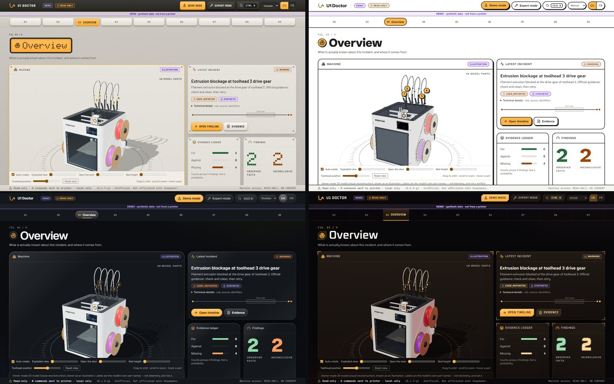
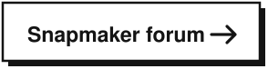
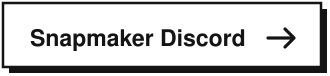

<a href="https://sirstormz.github.io/u1-doctor/"><picture>
<source media="(prefers-color-scheme: dark)" srcset="docs/media/readme/banner-dark.svg">

</picture></a>

 <a href="README.fr.md">Français</a>

<a href="https://github.com/SirStormz/u1-doctor/releases/latest"><b>Download for Windows</b></a> &nbsp;|&nbsp;
<a href="https://sirstormz.github.io/u1-doctor/"><b>Website</b></a> &nbsp;|&nbsp;
<a href="https://sirstormz.github.io/u1-doctor/sample-report/"><b>Sample report</b></a> &nbsp;|&nbsp;
<a href="docs/INSTALL.md"><b>Install guide</b></a>

> Unofficial. Not affiliated with, endorsed by, or approved by Snapmaker.

https://github.com/user-attachments/assets/d7ad3b51-ea4c-40c8-b4de-bf7bd6530c2a

## Three questions, three answers

<picture>
<source media="(prefers-color-scheme: dark)" srcset="docs/media/readme/questions-dark.svg">

</picture>

U1 Doctor runs on your own PC. The decoder knows the 413 official codes; a code it does not know gives "inconclusive", never a guess.

## It only looks

<picture>
<source media="(prefers-color-scheme: dark)" srcset="docs/media/readme/readonly-dark.svg">

</picture>

It cannot pause, cancel, restart or send G-code. It reads a printer only if you type its private address and tick an approval box, through a fixed list of at most 13 read-only requests (GET). Details: [threat model](docs/threat-model.md) and [SECURITY.md](SECURITY.md).

## No guessing

<picture>
<source media="(prefers-color-scheme: dark)" srcset="docs/media/readme/replay-dark.svg">

</picture>

Every fact keeps its source. Rules are a pure function, so anyone can replay a bundle and get the same result. What it does not claim: [limits](docs/LIMITS.md).

## Get started (Windows)

1. Download `u1-doctor-0.4.0-g1-win64.zip` from the [latest release](https://github.com/SirStormz/u1-doctor/releases/latest).
2. Right-click it, **Extract all**, then double-click `u1-doctor.exe`.
3. Switch on **Demo mode** to try it with clearly labelled synthetic data, or open **Diagnose** to read your own U1.

Checksum, SmartScreen, Linux, macOS and Docker: [install guide](docs/INSTALL.md).

## Four themes

Pick one in Settings. A theme changes the look only, never what the app says.

## Help wanted: a real failure

<picture>
<source media="(prefers-color-scheme: dark)" srcset="docs/media/readme/help-dark.svg">

</picture>

<a href="https://github.com/SirStormz/u1-doctor/issues/new?template=incident-report.yml"><picture><source media="(prefers-color-scheme: dark)" srcset="docs/media/readme/button-report-dark.svg"></picture></a>
<a href="https://forum.snapmaker.com/t/44124"><picture><source media="(prefers-color-scheme: dark)" srcset="docs/media/readme/button-forum-dark.svg"></picture></a>
<a href="https://discord.com/invite/snapmaker-official-1086575708903571536"><picture><source media="(prefers-color-scheme: dark)" srcset="docs/media/readme/button-discord-dark.svg"></picture></a>

Not sure what to send? <a href="docs/SHARE_A_REPORT.md">How to share a report, in two minutes</a>. Nothing is ever sent by the app itself.

## Go deeper

| | |
|---|---|
| [How it works](docs/HOW-IT-WORKS.md) | The 28 rules, their sources and limits |
| [Everything it does](docs/OVERVIEW.md) | All screens, what works today, safety model, run from source |
| [Install](docs/INSTALL.md) and [log files](docs/LOGS.md) | Checksums, other systems, reading exported logs |
| [U1-DEB format](docs/U1-DEB.md) and [API](docs/API.md) | The evidence bundle and the local API |
| [Contributing](CONTRIBUTING.md) | Code, tests, how to help |

## License

MIT, see [LICENSE](LICENSE). The official Snapmaker repositories (`u1-klipper`, `u1-moonraker`, `u1-fluidd`) are GPL-3.0; no code is copied from them. Error-code descriptions are short paraphrases with links to the official wiki.
