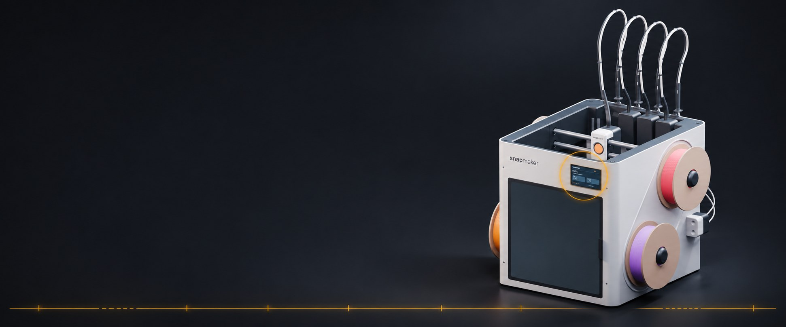
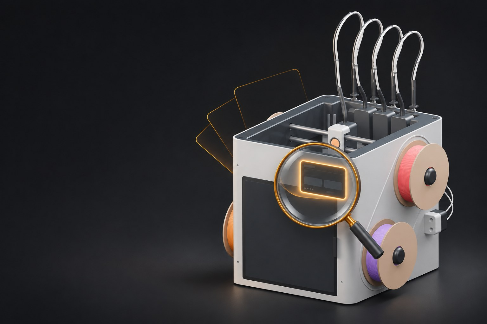
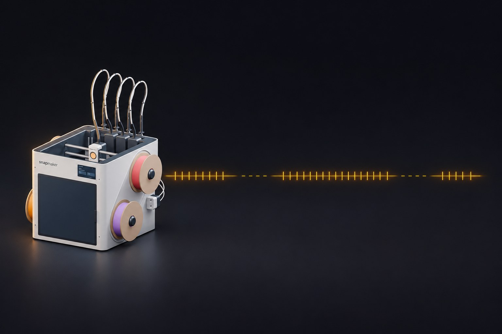
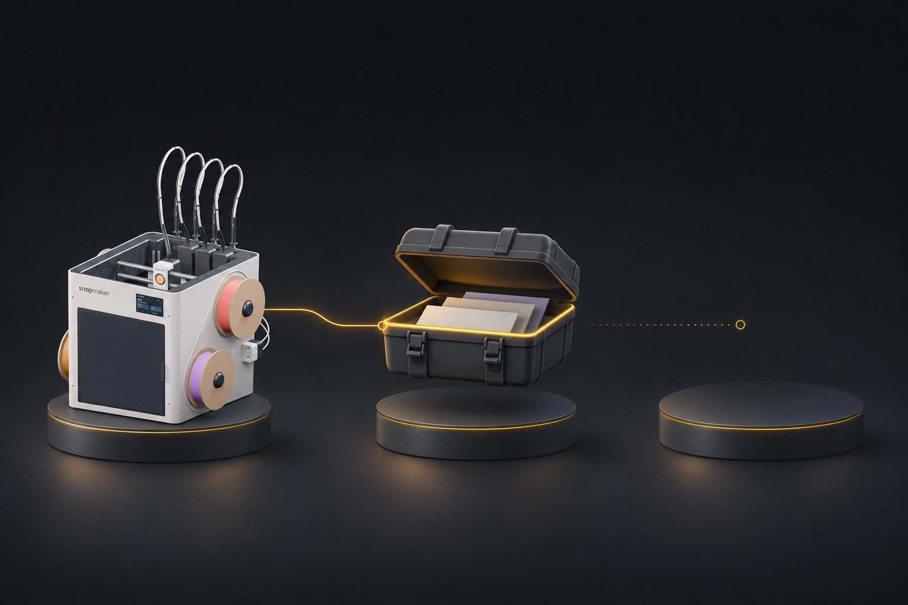
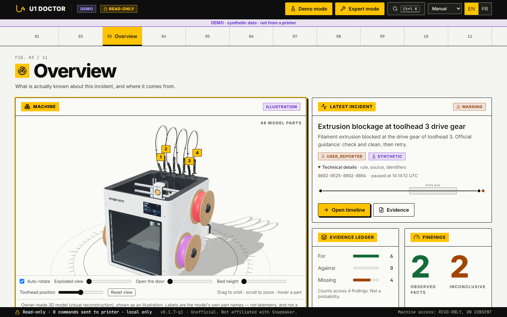
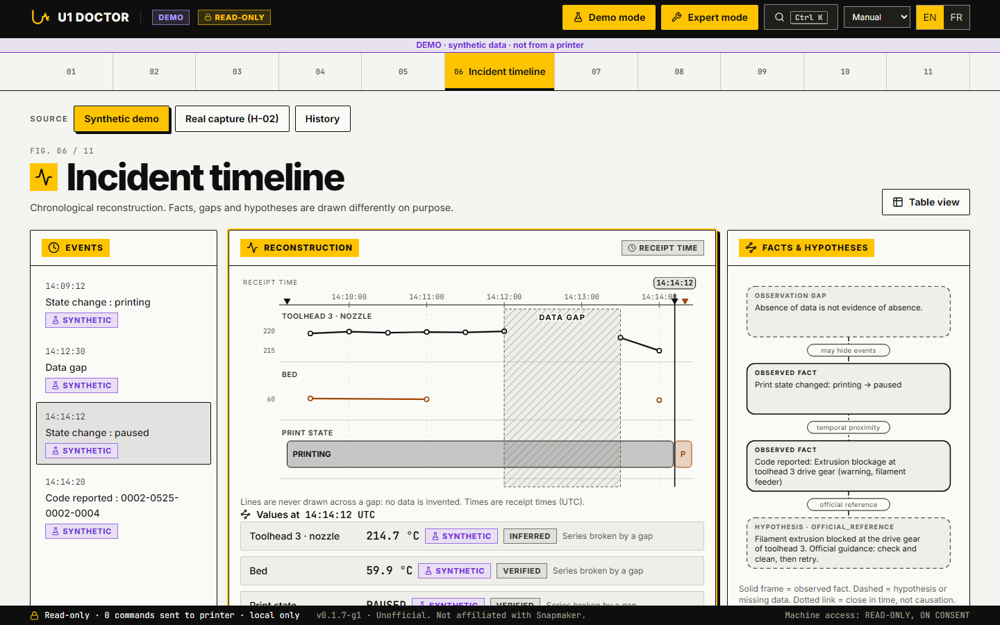
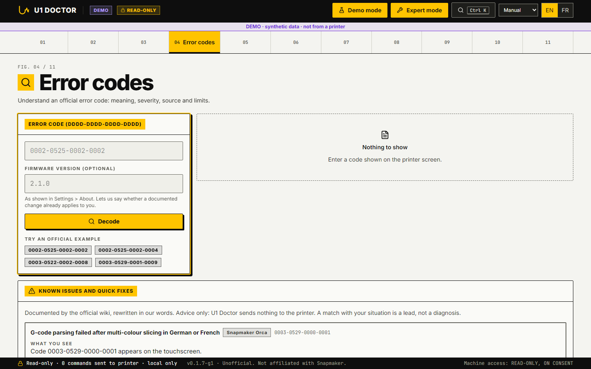
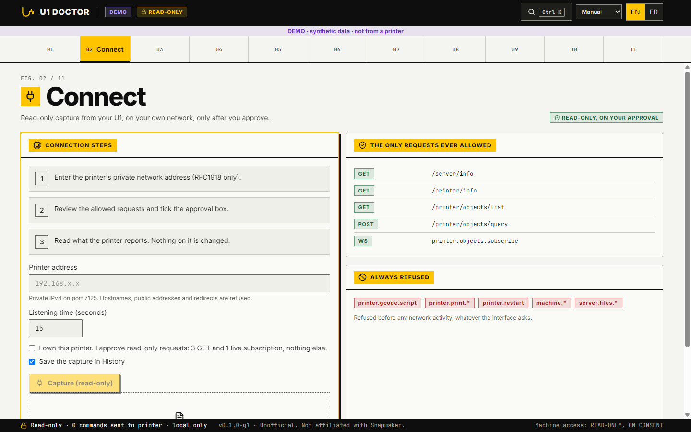

<p align="center"></p>

<h1 align="center">U1 Doctor</h1>

<p align="center"><b>When a print stops, know what happened, and why you can trust the answer.</b><br>
A local, read-only evidence tool for the Snapmaker U1. No cloud, no telemetry, no AI.</p>

<p align="center">
<a href="https://github.com/SirStormz/u1-doctor/actions/workflows/ci.yml"></a>
<a href="https://github.com/SirStormz/u1-doctor/releases/latest"></a>
<a href="LICENSE"></a>


</p>

<p align="center">
<a href="https://github.com/SirStormz/u1-doctor/releases/latest"><b>Download for Windows</b></a> &nbsp;·&nbsp;
<a href="https://sirstormz.github.io/u1-doctor/presentation/"><b>Illustrated presentation</b></a> (EN/FR) &nbsp;·&nbsp;
<a href="https://sirstormz.github.io/u1-doctor/sample-report/"><b>Sample report</b></a> (synthetic data) &nbsp;·&nbsp;
<a href="docs/INSTALL.md"><b>Install guide</b></a> &nbsp;·&nbsp;
<a href="docs/LIMITS.md"><b>What it does not do</b></a>
</p>

> Unofficial. Not affiliated with, endorsed by, or approved by Snapmaker.

https://github.com/user-attachments/assets/b164399f-4021-45d3-b8f1-79cc4562f80d

---

## What is it, in plain words?

Your U1 pauses or shows an error code. You want to know what the code means, what the printer was doing just before, and what you can show a friend or Snapmaker support, without guessing.

U1 Doctor runs **on your own PC**. It gives you three things:

<table>
<tr>
<td width="33%" valign="top"><br><b>1. What does this code mean?</b><br>An offline decoder for 413 official U1 error codes, with a link to the official page. A code it does not know gives "inconclusive", never a guess.</td>
<td width="33%" valign="top"><br><b>2. What happened, and when?</b><br>A timeline built only from facts that were really observed, with the gaps shown instead of hidden.</td>
<td width="33%" valign="top"><br><b>3. What can I show someone else?</b><br>A portable evidence bundle (<code>U1-DEB</code>) that anyone can open and replay on their own PC, to get the same result.</td>
</tr>
</table>

**It only looks. It never touches your printer.** It cannot pause, cancel, restart or send G-code. It can read from a printer only if you type its address and tick an approval box, and even then through a short, fixed list of read-only requests.

## A quick look

| Overview | Incident timeline | Error codes |
|---|---|---|
|  |  |  |

Screenshots were taken in **Expert mode** with **demo mode** on, which shows the built-in **synthetic demo data** (the `DEMO` banner is visible whenever it is on). All 11 screens are in [`docs/media/screens/`](docs/media/screens/).

## What is inside: the 11 screens

| # | Screen | What you do there |
|---|---|---|
| 01 | **Welcome** | What the tool is, and its promises: no account, no cloud, no AI, nothing leaves your PC |
| 02 | **Connect** | Take a short **read-only capture** of your own U1: type its private address, tick the approval box. A new observed finding or an error/shutdown state in the result raises an **on-screen alert** (banner + `(!)` in the window title; no system notification, can be turned off in Settings) |
| 03 | **Overview** | What is actually known about the incident and where it comes from, with the U1 in 3D (illustrative controls) |
| 04 | **Error codes** | Decode any of the 413 official codes. Also here: firmware notes, which toolheads to inspect, the "what support will ask" checklist, 5 documented known issues, **known issues per firmware version** (13 dated, sourced entries from 1.0.0 to 2.1.0, filterable by version, may be out of date), causes **reported by the community** on the forum (11 entries, each with its topic link, never official), 3 **good-to-know notes** reported by the community (camera not shown in Fluidd, read-only configuration files until Advanced Mode, encrypted logs), "did you mean" for mistyped codes, explanations for 8 messages that carry no code, and an offline **G-code pre-flight** (20 checks on a sliced `.gcode` or on the G-code inside a sliced `.3mf`) |
| 05 | **Print quality** | The "needs your eyes" assistant: 16 symptoms, causes in the official order, evidence only from numbers you type or saved temperatures. No ranking, no score |
| 06 | **Incident timeline** | The observed window with phases and explicit gaps. Also here: the **History** of your saved sessions (never merged) and the import of **U1 Dry Run** reports |
| 07 | **Findings** | Every conclusion of the 20 rules (live rules S22-S24 fired on a real U1 print on 2026-11-08, S17-S21 stayed quiet there and are UNTESTED on a real fault), ordered by status then evidence quality. Open one to see what supports it, what contradicts it, what is missing and its limits |
| 08 | **Evidence detail** | The observations behind every finding, with source, time quality and hashes (in the menu in Expert mode; in Simple mode it opens from "Open" on a finding) |
| 09 | **Replay lab** | Rerun the rules on frozen synthetic data and check the result is identical, byte for byte (in the menu in Expert mode) |
| 10 | **Report composer** | Prepare a privacy-checked **evidence bundle** of the demo scenario or of **your own saved capture**, import someone else's, and copy a **ticket-ready summary** (versions, code, toolhead, LAN or cloud, filaments, what you tried, capture facts) for a support ticket or a forum post |
| 11 | **Settings** | Language (English or French), **Simple or Expert** display level, 3 themes, 2 densities, replay of the guided start, versions and the compatibility list |

Press `Ctrl K` anywhere to jump to a screen or paste an error code.

**Simple or Expert.** The *Expert mode* switch in the header (or the display level in Settings) chooses how much you see. **Simple** (the default) keeps plain language and folds the technical part of each block under *Technical details*; **Expert** shows all 11 screens and opens those details. In Simple, the folded parts are rule and catalogue identifiers, the raw parts of an error code, the method notes of the print-quality assistant and the file hashes of the support bundle; the meaning, severity, official links, evidence, provenance labels (DEMO, SYNTHETIC, USER_REPORTED, IMPORTED, REAL), community sources and export buttons always stay in view. Nothing is removed in Simple: you can still open any detail, and the two expert screens stay one click away.

**Hints.** In Simple mode, once the first-start assistant is closed, three short notes appear once each, next to what they explain: the *Observed / Suspected / Missing* marks, how to read the incident timeline, and the `Ctrl K` search button. *Got it* (or `Esc`) hides a note for good; *Replay the guided start* in Settings brings them back.

**First start.** A three-step assistant asks for your language and display level, offers the demo or the connection to your own printer, and explains the three marks used everywhere (*Observed*, *Suspected*, *Missing*). Press `Esc` to skip it. A *Getting started* list on the Overview ticks itself as you use the app; both can be replayed from Settings.

## Get started in two minutes (Windows)

1. Download `u1-doctor-0.1.8-g1-win64.zip` and its `.sha256.txt` from the [latest release](https://github.com/SirStormz/u1-doctor/releases/latest).
2. Check the file was not altered (optional, 10 seconds):
   ```powershell
   Get-FileHash .\u1-doctor-0.1.8-g1-win64.zip -Algorithm SHA256
   ```
   Compare with the value in the release notes: `265D992EC37D537D861D03183B765148A48F3C5F0671BD67FC64339F554A5E07`.
3. Right-click the zip, **Extract all** (not WinRAR or 7-Zip, so Windows keeps the download mark), then double-click `u1-doctor.exe`.
4. A window opens with the app: no console, no browser. If the Microsoft WebView2 component is missing (some Windows 10 PCs), the app offers to install it once with Microsoft's own installer shipped in the zip (internet and a Windows permission prompt needed).

**Good to know**
- The app is **not code-signed**, so Windows SmartScreen may warn: choose "More info", then "Run anyway".
- If the window cannot start, the app opens in your browser instead and writes the reason to `%APPDATA%\U1 Doctor\error.log`. Your user folder path is replaced by `%USERPROFILE%` in that file, but read it before attaching it to an issue: it may still hold other folder or file names.
- VirusTotal: this 0.1.8-g1 zip has **not been scanned yet** (SHA-256 above, so you can look it up yourself). The previous builds scored 0 engines out of 52 for 0.1.7-g1 ([report](https://www.virustotal.com/gui/file/137d74a73cd12687844c781186b1bcd21002bcf53f3735b1e0b0b0aa2442d4e7)) and 0 engines out of 67 for 0.1.6-g1 ([report](https://www.virustotal.com/gui/file/b744d8c9cf7b3a275aa474fc8a44fd7c3e9cbc3c1a00ce73002df798add2fb92)). Earlier builds: 0.1.0-g1 was flagged by 1 engine out of 66, 0.1.1-g1 by 2 out of 65, 0.1.2-g1 by 1 out of 66 (Zillya, `Trojan.Stealer.Win64.2764`) and 0.1.5-g1 by 0 out of 65 ([report](https://www.virustotal.com/gui/file/594599bf711db552a6e8b01c27c25f642b6c816a162cfdf7d57410ae6b8812b9)); we believe the earlier detections were false positives typical of unsigned PyInstaller executables. A clean scan is not a guarantee and detections can change: the source is public, the build is made by GitHub Actions, and the app reads no browser data, cookies, passwords or clipboard. It reads one Windows registry value (the installed WebView2 version, to know whether its window can open) and removes the "downloaded from the Internet" mark from the `.dll` files inside its own bundled `_internal` folder (and no other file, not even other files you put next to the exe) so that window can start.
- It opens with a short **first-start assistant** (skippable), then **starts empty**: nothing is shown until you import a bundle or capture a printer. The **Demo mode** switch in the header fills the screens with clearly labelled synthetic data (off again at every start). Everything works offline and nothing is sent anywhere.
- Linux, macOS and Docker: see the [install guide](docs/INSTALL.md).

## Use it with your own U1

1. Open the **Connect** screen.
2. Type your printer's private address (for example `192.168.x.x`).
3. Read the list of allowed requests, tick **"I own this printer"**, press **Capture (read-only)**.
4. You get what the printer reports (state, versions, temperatures over time) and the findings from the rules, with the capture saved to the History if you wish.
5. To keep or share it, open the **Report composer**, choose your capture under *Report source*, check the privacy scan and press **Export bundle**. The bundle can be opened and replayed on any other PC.



The capture never contains your address or file names. It sends 5 GET requests (one of them, `/server/files/directory?path=logs`, only reads the free space of the log partition; another, `/server/history/totals`, only reads four job totals of the print history for the maintenance reminders) and 1 live subscription message. If the live stream closes early, the app checks with up to 6 more read-only status GET requests whether the printer itself still answers, so a lost connection is not mistaken for a stopped printer: 11 GET at most.

**Maintenance reminders (UNTESTED on a real U1).** In Settings you keep a small local list of tasks with an interval in print hours, jobs or tool changes and the totals at which you last did them. After a capture the app compares them with the printer's job-history totals and the `switch_count` counters (as the firmware reports them; their meaning is not documented officially) and shows what is due, with the numbers left: no prediction, nothing sent anywhere. Two presets come from official Snapmaker wiki pages (PEI sheet wash every 5-10 prints, pogo-pin contact cleaning every 100,000 swaps), each with its link and check date; anything else is your own task.

**Live rules and connectivity self-check.** From the same capture, eight rules (S17-S24) report the spread of the toolhead Y offsets, implausible bed or cavity readings, a heater that does not warm up, nozzle diameters that disagree (with a G-code you analysed in the app), a controller clock reset while printing, the log partition usage, toolhead counters and bed-mesh numbers. They were written from forum reports. One supervised read-only capture on the owner's U1 (firmware 2.1.0, printing, 2026-11-08; 4 GET and 1 subscription, nothing written) read every source and fired S22, S23 and S24; S17 to S21 stayed quiet on that healthy print, so their positive case has never been seen on a real printer. Each rule says "not observable" when the printer does not report the data. The Connect screen also shows how long each request took, whether the stream dropped and whether the address changed since the last capture (only a keyed fingerprint of the address is kept, never the address).

## What works today

| Feature | State |
|---|---|
| Offline decoder for 413 official error codes (paraphrased, with link) | tested on synthetic data |
| Deterministic rules engine: same observations and same rule set always give the same findings and the same hash. 20 rules | tested on synthetic and real-capture data, on Windows, Linux and macOS (identical replay hash in CI) |
| Explainable findings: evidence for, evidence against, what is missing, limits, official references. No score, no percentage | tested |
| Read-only live capture from the Connect screen, with read-only probes if the stream closes early | tested against a mock and on the owner's U1 (no write ever sent) |
| Saved-session **history** and import of U1 Dry Run reports | tested |
| **G-code pre-flight**: 20 offline checks on a sliced `.gcode` or the G-code embedded in a sliced `.3mf` (for example decimal commas, a 0 °C bed, nozzle diameter, `#` in the file name; and, from community reports, M191, a start line at Y1, the probing temperature, tool order and auto-mapping, another printer's profile, prime tower outside the bed, TPU settings, purge used, a final travel at the last layer height) | tested on synthetic files |
| Known issues per firmware version: 13 entries (official release notes or labelled community reports, checked 2026-11-08) | tested |
| "What support will ask" checklist per code, firmware notes, 5 documented known issues | tested |
| Community-reported causes: 11 entries covering 25 codes (forum topics read 2026-11-08, labelled as community reports), near-match for mistyped codes, matcher for 8 messages without a code | tested |
| Ticket-ready summary (copy to clipboard, nothing sent) and a "save the bundle now" reminder in the capture and history screens | tested |
| **Sample report** on GitHub Pages ([`docs/sample-report/`](https://sirstormz.github.io/u1-doctor/sample-report/)): the ticket-ready summary and the findings of the SYNTHETIC demo incident, built by the app's own Report-composer code (`npm run sample-report` in `frontend/` regenerates it) | tested (a test checks it is up to date, labelled SYNTHETIC and free of external requests) |
| On-screen alert when a capture or a replay ends with a new observed finding or an error/shutdown state: in-page banner and `(!)` title prefix only, no OS notification, toggle in Settings (on by default) | tested on mocked results |
| Good-to-know notes: 3 community-reported notes (forum topics re-read 2026-11-08, labelled not official) | tested |
| Print-quality assistant ("needs your eyes"): 16 symptoms, causes in the official order, evidence only from numbers you type or saved temperatures | tested |
| Timeline of the **observed window**: phases, explicit gaps, source and time quality per row | tested on real captures and 20 synthetic scenarios |
| `U1-DEB` evidence bundle: **export of the demo scenarios or of your own saved captures**, safe import and replay ([spec](docs/U1-DEB.md)) | tested; a ready-made example and a validator are in the repo |
| Windows build (one folder, no Python needed) | started and checked on the developer PC; an earlier build passed the second-PC test kit on a clean Windows 11 PC; the SmartScreen prompt and a PC without WebView2 are **not yet tested** |
| English and French interface | both complete |

**Honest status:** the real captures come from the owner's own U1 (firmware 2.1.0) and are normal prints: a 27-minute print (9,333 frames) and a 55-minute multi-colour print (18,339 frames). **No real fault has been captured yet**, so every incident you can open in the app is labelled `SYNTHETIC`. That is the main thing this project still needs: see [real incidents wanted](#real-incidents-wanted).

## Safety model

U1 Doctor never controls the printer.

- One single module may open a network connection to a printer. The web interface reaches it through one route (`POST /api/v1/live/capture`) that refuses to run without explicit owner consent, accepts one private IPv4 address, and rejects requests that do not come from the app itself.
- Every request is checked against a frozen allowlist **before** any network I/O: `GET /server/info`, `GET /printer/info`, `GET /printer/objects/list`, `GET /server/files/directory?path=logs` (that exact query only) and one WebSocket method, `printer.objects.subscribe`, with a fixed list of object names. Anything else is refused, including `POST /printer/objects/query`, which the app never needed.
- The local API refuses any POST or DELETE that does not come from the app's own page (foreign `Origin` or missing `X-U1D` header), so another web page open in your browser cannot drive it.
- Pause, resume, cancel, restart, emergency stop and `printer.gcode.script` are covered by tests that must stay refused.
- Supervised sessions on the owner's U1 (scripted runs, a capture from the Connect screen and a 55-minute passive watch of a print) recorded **0 non-read operations**. The evidence is in [`docs/evidence/`](docs/evidence/).
- The app listens on `127.0.0.1` only. Nothing leaves your machine.

Details: [`docs/threat-model.md`](docs/threat-model.md), [`docs/capability-matrix.md`](docs/capability-matrix.md), [`SECURITY.md`](SECURITY.md).

## What it does not claim

- A lost connection never means the printer stopped.
- The timeline describes the observed window only. No gap record does **not** prove the data is complete.
- Timestamps are the PC's receipt time unless proven otherwise. Machine clocks are never read as UTC.
- A SHA-256 on a bundle proves **integrity only**, never who made it.
- The official wiki warns that the displayed code may not be the real fault. The decoder reports what the code says, not a diagnosis.
- Two rules rest on thresholds measured on a single print (a hot nozzle with its fan at zero, for one). They say so in their findings and rate themselves weak.
- Export redaction is best effort and is not a guarantee of anonymity. Review a bundle before sharing it.

Full list, each limit with its source: [`docs/LIMITS.md`](docs/LIMITS.md).

## Why owner-readable evidence

According to the official Snapmaker wiki, the U1's exported system logs are encrypted: the archive cannot be read locally, and only Snapmaker support can open it. U1 Doctor does not read or decrypt those logs. It gives the owner something different: readable, hash-verifiable evidence built from read-only observations the owner authorizes, which can be inspected and replayed locally. Source: [`docs/wiki-findings.md`](docs/wiki-findings.md), section 2.

## How it works

```
observations (REAL / SYNTHETIC / USER_REPORTED / IMPORTED)
        |
        v
timeline + rules engine (pure function, pinned rule set)
        |
        v
findings --> U1-DEB bundle (export / safe import / replay)
```

Every fact carries its source and a time-quality marker. Findings point back to the observations that produced them. Imported bundles are labelled `IMPORTED`, and their findings are always recomputed with your local rule set. **One-page summary of the 20 rules, their sources and limits, the live-read budget and a comparison with community tools: [`docs/HOW-IT-WORKS.md`](docs/HOW-IT-WORKS.md).** Architecture: [`docs/architecture.md`](docs/architecture.md).

## Real incidents wanted

The rules were written from the official documentation and tested on one healthy printer. What would improve them most is a **real incident**: the error code that appeared, the firmware, when it happened and what U1 Doctor said, optionally with an evidence bundle of your capture (Report screen, choose your saved capture, Export bundle). If you have one, [open an incident report](https://github.com/SirStormz/u1-doctor/issues/new?template=incident-report.yml): a short form, and nothing is sent by the app itself. Read [how to share a report](docs/SHARE_A_REPORT.md) first: issues are public, so never include serial numbers, addresses or file names.

## Run from source

Requirements: Python 3.12 or newer, Node.js with npm.

```powershell
cd backend
py -3.12 -m venv .venv
.venv\Scripts\python.exe -m pip install -e ".[dev]"
cd ..\frontend
npm ci
npm run build
cd ..\backend
.venv\Scripts\python.exe -m app
```

Open <http://127.0.0.1:8765>. Set `U1DOCTOR_PORT` to change the port.

Tests:

```powershell
cd backend; .venv\Scripts\python.exe -m pytest
cd frontend; npm test
```

At the time of writing: 1,166 backend tests, 150 frontend tests and 16 browser (Playwright) tests pass, with `ruff`, `mypy` and `tsc` clean. CI runs the same checks on Windows, Linux and macOS.

## More documentation

- [`docs/HOW-IT-WORKS.md`](docs/HOW-IT-WORKS.md): one page on the rules, provenance, the live-read budget and how U1 Doctor differs from community tools.
- [`docs/INSTALL.md`](docs/INSTALL.md): install guide (executable, source, Docker) and where your data lives.
- [`docs/U1-DEB.md`](docs/U1-DEB.md): the evidence bundle format and its validator.
- [`docs/LIMITS.md`](docs/LIMITS.md): what is not covered or not yet proven.
- [`docs/spec/`](docs/spec/): the original requirements and the read-only hardware test protocol (in French).
- [`CONTRIBUTING.md`](CONTRIBUTING.md): tests, conventions, honesty rules.
- [`SECURITY.md`](SECURITY.md): the read-only allowlist and how to report a vulnerability privately.

## Related community projects

U1 Doctor is not a dashboard and does not drive the printer. Nearby projects that do other jobs:

- [U1 Print Hub](https://github.com/dlgambill/u1hub) (MIT): farm dashboard, queue, scheduling and a per-printer logbook. It sends commands to the printers. U1 Doctor only reads.
- [Snapmaker Studio](https://github.com/DVOpenLabs/snapmaker-studio) (MIT): checks a 3MF or STL file before slicing.
- [U1 Dry Run](https://github.com/DesignMaster-Solutions/u1-dryrun) (GPL-3.0): runs sliced G-code through the real U1 firmware without a printer.

No code is copied from these projects. The comparison is in [`docs/ORIGINALITY_AUDIT.md`](docs/ORIGINALITY_AUDIT.md).

<details>
<summary><b>En français</b></summary>

**U1 Doctor** est un outil local et en lecture seule pour la Snapmaker U1. Quand une impression s'arrête, il t'aide à répondre à trois questions sans deviner : que veut dire ce code d'erreur (décodeur hors ligne de 413 codes officiels), que s'est-il passé et quand (frise construite uniquement avec des faits observés), et que montrer à quelqu'un d'autre (un paquet de preuves `U1-DEB` que chacun peut rouvrir et rejouer chez soi).

- **Il ne pilote jamais l'imprimante** : ni pause, ni annulation, ni G-code. Il ne lit une imprimante que si tu saisis son adresse privée et coches la case d'accord, avec une courte liste fixe de requêtes de lecture.
- **Tout reste sur ton PC** : pas de cloud, pas de télémétrie, pas d'IA. L'application n'écoute que sur `127.0.0.1`.
- **Démarrer** : télécharge le zip de la [dernière release](https://github.com/SirStormz/u1-doctor/releases/latest), extrais-le avec « Extraire tout », double-clique `u1-doctor.exe` : une fenêtre s'ouvre avec l'application (sans console ni navigateur ; si le composant Microsoft WebView2 manque, l'app propose de l'installer une fois). Windows peut afficher un avertissement SmartScreen, car l'exe n'est pas signé.
- **Bilingue** : l'interface existe en français et en anglais, avec un bouton en haut à droite.
- **Statut honnête** : seules des impressions normales ont été capturées sur une vraie U1 ; aucune panne réelle pour l'instant, donc tous les incidents de démonstration sont marqués `SYNTHETIC`. La [présentation illustrée](https://sirstormz.github.io/u1-doctor/presentation/) est aussi disponible en français. Un [exemple de rapport](https://sirstormz.github.io/u1-doctor/sample-report/) bilingue, produit à partir de l'incident de démonstration synthétique, est en ligne.

</details>

## License

MIT, see [`LICENSE`](LICENSE). The official Snapmaker repositories (`u1-klipper`, `u1-moonraker`, `u1-fluidd`) are GPL-3.0; no code is copied from them. Error-code descriptions are short paraphrases with links to the official wiki.

"Snapmaker" and "U1" are trademarks of their owner. They are used here only to say which printer this tool is for.
