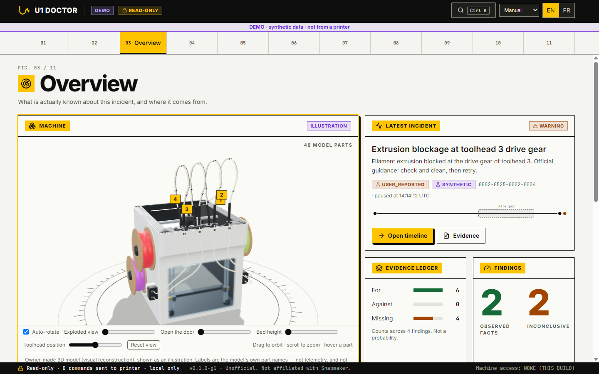
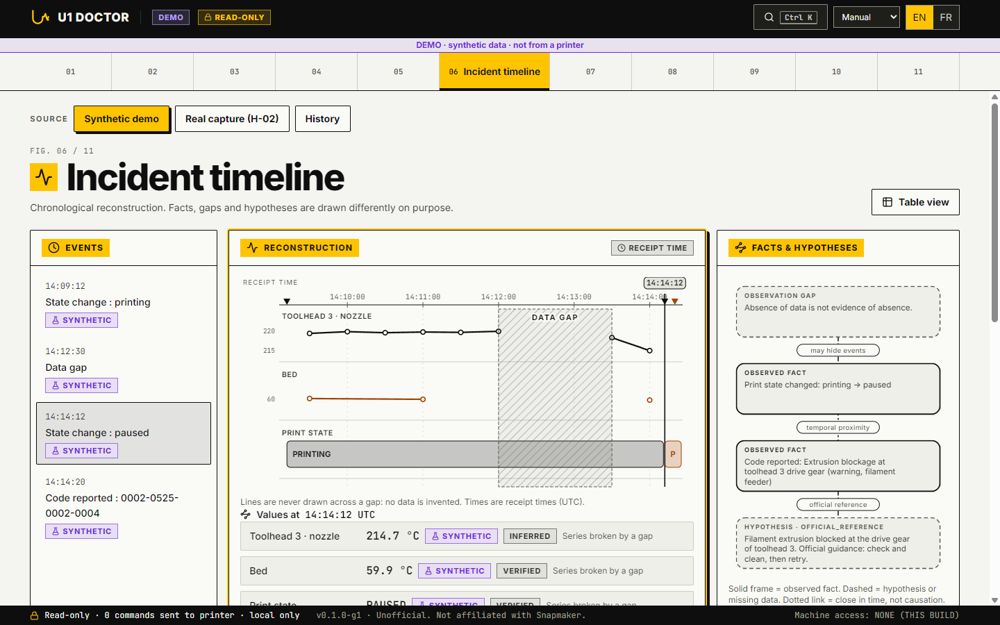
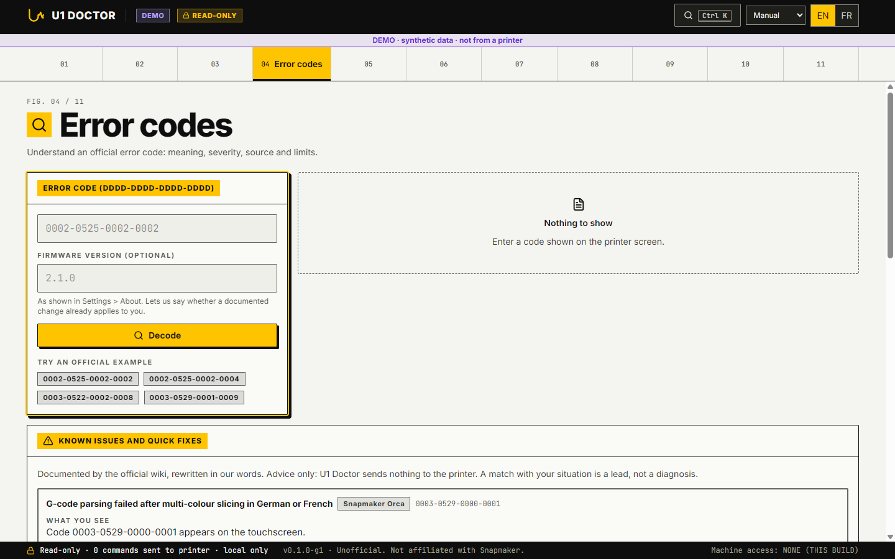

# Install U1 Doctor

U1 Doctor is an unofficial, local, read-only diagnostic tool for the Snapmaker U1. It runs on your PC and listens on `127.0.0.1` only.

Screenshots of the real UI, taken with the built-in **synthetic demo data** (not from a printer; the DEMO banner is visible on every screen):

| Overview | Incident timeline | Error codes |
|---|---|---|
|  |  |  |

All 11 screens are in [`docs/media/screens/`](media/screens/).

## Before you start: what is and is not verified

- **No release exists yet.** Option A below describes how a release will be installed; there is nothing to download today.
- The Windows build has run on the developer PC only. It has **not yet been tested on a clean Windows 11** and has **not yet been antivirus-scanned**.
- The executable is unsigned, so Windows SmartScreen may warn.
- Source: `IMPLEMENTATION_STATUS.md` (REQ-015), `BACKLOG.md`.

## A. Windows executable (from a release, once published)

1. Download the release zip and its SHA-256 from the release page (link to be added at publication).
2. Verify the hash in PowerShell before unpacking:

   ```powershell
   Get-FileHash .\u1-doctor-windows.zip -Algorithm SHA256
   ```

   Compare the output with the published value: `SHA256_TO_FILL_AT_RELEASE`. If they differ, do not run the file.
   (A SHA-256 proves the file was not altered or corrupted. It does not prove who made it.)
3. Unpack the zip (one folder, no Python needed) and run `u1-doctor.exe`.
4. Open <http://127.0.0.1:8765>. Set `U1DOCTOR_PORT` to change the port.

The build is produced by `scripts\build_windows.ps1`. It bundles the owner's 3D model (`frontend/public/models/u1-jay.glb`).

## B. From source (Windows PowerShell)

Requirements: Python 3.12 or newer, Node.js with npm.

```powershell
cd backend
py -3.12 -m venv .venv
.venv\Scripts\python.exe -m pip install -e ".[dev]"
cd ..\frontend
npm ci
npm run build
cd ..\backend
.venv\Scripts\python.exe -m app
```

Open <http://127.0.0.1:8765> (`python -m app` serves on `127.0.0.1:8765`; `U1DOCTOR_PORT` changes the port).

For frontend development, run the backend as above and, in another terminal:

```powershell
cd frontend
npm run dev
```

Vite serves on port 5173. A bare URL shows the landing page; `#/overview` opens the app.

## B2. With Docker (any OS with Docker)

```
docker build -t u1-doctor .
docker run --rm -p 127.0.0.1:8765:8765 -v u1doctor-data:/data u1-doctor
```
Then open `http://127.0.0.1:8765`. Publish the port on `127.0.0.1` only, as above: the app has no login and must not be exposed on a network. Inside the container it listens on all interfaces (`U1DOCTOR_HOST=0.0.0.0`, set by the image) so the published port works; it still refuses requests whose `Host` header is not `127.0.0.1` or `localhost`. The image runs as a non-root user and keeps its database in the `/data` volume. It does not contain the 3D model (the app shows a still image instead). Built and run on the developer PC only; the image is not published anywhere.

## C. Where your data lives

| Run mode | Database file |
|---|---|
| Executable | `~/.u1-doctor.sqlite3` (your user folder) |
| From source (`python -m app`) | `u1doctor.sqlite3` in the current folder |
| Either | set `U1DOCTOR_DB` to choose another path |

It is a local SQLite file holding saved replays and the history of observation sessions. Nothing is sent anywhere.

## D. First steps in DEMO mode (no printer needed)

Everything works offline. The **Connect** screen is the only part that can reach a printer, and only after you type its private address and tick the approval box.

1. Open the app. A banner and a mode badge show **DEMO** at all times.
2. Look up an error code in the offline decoder. An unknown or malformed code gives `INCONCLUSIVE`, never a guess.
3. Open a scenario and read its timeline and findings (evidence for, evidence against, what is missing, limits, official references).
4. Every synthetic scenario is labelled `SYNTHETIC`. The only real data is one recorded capture of a normal print (labelled as real, with no fault in it).
5. Export an evidence bundle (U1-DEB) and re-import it to replay it locally. See [`U1-DEB.md`](U1-DEB.md).

## E. The read-only guarantee

1. U1 Doctor never controls the printer: no pause, resume, cancel, restart, emergency stop or G-code.
2. Only one transport module may open a network connection to a printer.
3. Requests are checked against a frozen allowlist before any network I/O: 4 HTTP requests and 1 WebSocket method.
4. The target must be a literal private (RFC1918) IPv4 address on port 7125, and a real connection needs explicit owner consent.
5. The app listens on `127.0.0.1` only; forbidden requests are covered by tests that must stay refused.

Details: [`threat-model.md`](threat-model.md). Known limits: [`LIMITS.md`](LIMITS.md).
