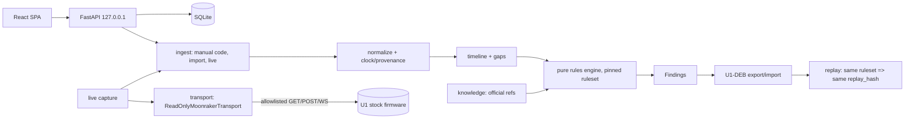

# Architecture (G0 design) — see cahier §5, §7, §8, §13

Local-first modular monolith: one FastAPI process bound to `127.0.0.1` serves a built React SPA and `/api/v1/*`. The browser never talks to the printer. Only `transport/` may open a socket to a U1.

## Principles
1. **Observation → Finding** one-way. Findings reference observation ids; `CONFIRMED_BY_PROTOCOL` needs `protocol_ref`; no probability field exists.
2. **Rules engine = pure function** `(observations, ruleset) → findings`; no clock, no I/O, no randomness. Declarative operators only (`eq, exists, within, count, all, any, not`); schema-validated; no `eval`/executable YAML.
3. **Canonical hashing**: JSON `sort_keys`, compact separators, UTF-8; `generated_at` excluded from `replay_hash`. Observations sorted by `(capture_utc, observation_id)`.
4. **Time**: store receipt UTC; Klipper `eventtime` kept raw, never UTC; sessions never merged across reboots without proof.
5. **Modes** always visible: OFFLINE / CONNECTED / DEMO / REPLAY; SYNTHETIC badge on all simulated data.
6. **Transport**: see ADR-0002. Policy is pure and unit-tested; policy runs before I/O; five HTTP GET ops (one with an exact query allowlist: `/server/files/directory?path=logs`; `/server/history/totals` takes no query) + one WS method with a fixed object-name allowlist; 11 GET at most per capture; owner `Consent` required for real network.

## Code present at end of G0
`backend/app/transport/{policy,readonly}.py` (+128 offline tests), `schemas/*.json`, `fixtures/synthetic/*`, `scripts/make_synthetic_example.py`. No FastAPI/React/SQLite code yet (G1).

## Open design decisions (for owner)
- Python 3.14 is installed locally; cahier says 3.12+. Windows packaging (PyInstaller/Nuitka vs Tauri) must be prototyped in G1/G5 before committing; pin interpreter used for the installer.
- Live capture of oneshot error codes (see source-audit §1) → decide polling `exception_manager` vs WS after H-01 evidence.
