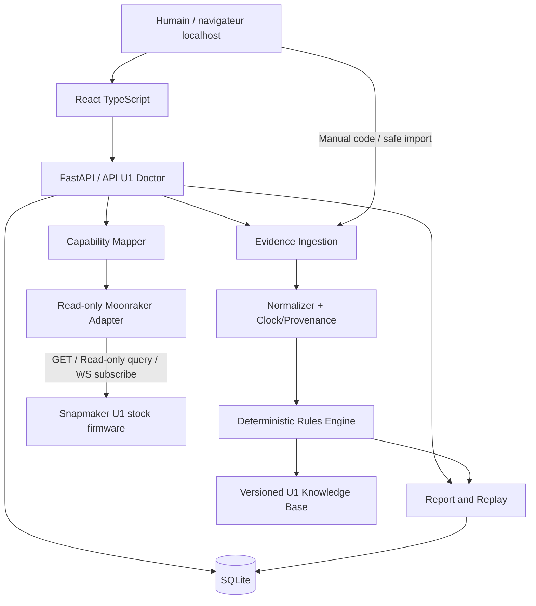

# U1 DOCTOR — DIAGNOSTIC FORENSICS ENGINE
## Cahier des charges maître — Édition Innovation Fund Phase 2

| Champ | Valeur |
|---|---|
| Document | `U1_DOCTOR_CAHIER_DES_CHARGES_V2.md` |
| Version | **2.0.0 — 5 novembre 2026** |
| État | **SPÉCIFICATION** — aucune application, connexion ou preuve matérielle n'est implicitement acquise |
| Cible | **Snapmaker U1 — firmware officiel**, priorité à **V2.1.0** (sorti le 4 novembre 2026) |
| Positionnement | **Diagnostic d'incidents fondé sur des preuves**, et non « un dashboard de plus » |
| Distribution | Gratuite, **open source**, non officielle ; application locale Windows en priorité |
| Langues | Interface FR + EN ; code, protocoles techniques et présentation du concours en EN |
| Mode par défaut | **Lecture seule**, aucune modification sur la machine |
| Propriétaire des décisions | L'utilisateur ; Claude Code intervient en ingénierie, QA et revue critique |
| Objectif compétition | **Candidature Cash Fund**, Innovation Fund Phase 2 ; viser une contribution technique testée et démontrable |

> **Règle cardinale : un diagnostic doit être explicable, reproductible, sourcé et prudent.** Ne jamais déclarer une panne « confirmée » sur la seule base d'une corrélation ou d'un message d'erreur. Les résultats DEMO/SYNTHETIC et les résultats MACHINE/REAL doivent être différenciés partout.

---

# 0. Executive brief — pourquoi ce projet pourrait compter

U1 Doctor transforme une succession de messages techniques difficiles à interpréter en **dossier d'incident reproductible** : contexte avant l'erreur, faits observés, hypothèses contradictoires, vérifications sûres, références Snapmaker et rapport de preuves partageable. Le logiciel ne promet ni réparation automatique ni accès magique aux journaux internes chiffrés.

**Différenciateur central :** un moteur de diagnostic U1 *versionné, déterministe, rejouable et vérifiable*, capable d'utiliser plusieurs provenances de données sans confondre l'absence de preuve avec la preuve d'absence.

**Le projet n'est pas :** un clone de Fluidd, Snap Studio, U1 Print Hub, un centre de gestion d'impression, une analyse caméra temps réel, un simulateur de G-code de type U1 Dry Run, ou un fork correctif du firmware comme U1 Fix Pack.

## 0.1 Les quatre démonstrations que les juges doivent comprendre

1. **CODE → CONTEXTE** : l'utilisateur saisit `0002-0525-0002-0002` ; U1 Doctor reconnaît le contexte « chargement du feeder 3 » *selon la référence officielle*, sans proposer une interprétation au-delà de la source.
2. **INCIDENT → TIMELINE** : un véritable incident sur la U1 se transforme en timeline horodatée, avec état des données et événements avant/après, uniquement pour la période effectivement observée.
3. **INDICES → HYPOTHÈSES** : plusieurs faits convergents déclenchent une signature traçable ; des indices contraires ou manquants réduisent la conclusion et guident les vérifications non dangereuses.
4. **DOSSIER → REPLAY** : un rapport d'incident anonymisé peut être rouvert sur un autre PC et rejoué avec la même version des règles pour obtenir **la même conclusion** ; chaque assertion pointe vers sa preuve.

L'ordre de développement privilégie les points 1, 2 et 4. Une seule signature réellement validée vaut davantage que vingt affirmations fragiles.

## 0.2 « Gagner » n'est pas une exigence testable

La récompense dépend du jury et du vote. On peut, en revanche, contrôler : stabilité, originalité du moteur, transparence des preuves, compatibilité stock, installation facile, documentation, feedback utilisateurs et qualité du dossier de candidature.

---

# 1. Contexte concours — règles à intégrer dans le pilotage

Source primaire : https://forum.snapmaker.com/t/read-first-about-the-innovation-fund-phase-2-project-submission-category/43732

- **Cash Fund** : voie recommandée pour quelqu'un qui possède déjà une U1.
- **Date effective de clôture des nouveaux sujets** : **23 décembre 2026 à 23:59 UTC**, soit **24 décembre 2026 à 00:59 CET** en Suisse. Publier avant, viser mi-décembre au plus tard.
- **Candidature** : sujet public dans la catégorie officielle, formulaire intégré, tags de type de financement et de catégorie, mises à jour par commentaires sur son propre sujet.
- **Évaluation annoncée** : vote communautaire **20 %** + comité technique **80 %** ; le top 60 Cash Fund du vote passe à l'examen approfondi après vérification initiale.
- **Axes évalués** : innovation ; profondeur technique et explicabilité ; produit terminé testé sur une **vraie U1** ; contribution à l'écosystème.
- **Original / Derivative** : déclarer honnêtement si le cœur est original ; dépendre de bibliothèques n'en fait pas nécessairement un dérivé ; réutiliser ou modifier le cœur d'un projet existant impose une déclaration de provenance.
- **Aucune auto-attribution** de prix, d'approbation ou d'affiliation officielle.

**Livrables concours obligatoires dans notre plan** : vidéo de 90–150 secondes ; capture de diagnostic **sur U1 réelle** ; démonstration du replay ; comparaison avant/après (temps ou pertinence diagnostique) ; dépôt GitHub public, release installable et guide rapide EN ; compte-rendu de tests et limites ; formulaire/forum à jour.

**Attention calendrier** : le règlement contient une tension entre l'estimation d'ouverture du vote « une semaine avant la clôture » et le tableau principal. Prioriser **la date précise de fermeture des nouveaux sujets** et vérifier les annonces officielles avant dépôt et vote.

---

# 2. Benchmark et périmètre concurrentiel

| Projet observé | Territoire principal | Décision pour U1 Doctor |
|---|---|---|
| Snap Studio | Atelier desktop, modèles, slicing, file d'impression, caméra, maintenance | Ne pas reconstruire un cockpit généraliste |
| U1 Print Hub | Fermes, files, surveillance, coûts, diagnostics applicatifs | Ne pas dupliquer la gestion de fermes |
| U1 Dry Run | Exécution/simulation de G-code sur code firmware | Ne pas simuler les mouvements dans le MVP |
| U1 Fix Pack | Correctifs Klipper et tests de régression firmware | Ne pas modifier le firmware |
| SliceGate | Préflight et analyse avant impression | Ne pas bâtir un checker géométrique généraliste |
| U1 Print Rescue | Idée de détection/intervention par caméra | Pas de caméra ni d'arrêt auto en V1 |

Sources : forum Snapmaker, voir bibliographie §24. Revalider le benchmark juste avant la candidature.

**Promesse volontairement étroite :** « U1 Doctor explains what happened on *your* U1, why it suspects specific causes, and what evidence you can share. »

---

# 3. Personae et parcours utilisateur

| Persona | Question principale | Parcours cible |
|---|---|---|
| Débutant | « Que signifie ce code ? » | Ouvrir > saisir code > fiche fiable et conseil sûr en moins de 30 s |
| Maker | « Pourquoi T3 échoue souvent ? » | Connecter > observer > consulter les incidents attribuables à une tête |
| Utilisateur expert | « Sur quels faits est basée la conclusion ? » | Ouvrir finding > événements > valeurs > sources > règles appliquées |
| Support | « Puis-je reproduire/qualifier le problème ? » | Importer rapport nettoyé > lire chronologie > références > limites |
| Contributeur | « Comment ajouter une signature ? » | Fixture > règle > tests > revue > release pack |

**Parcours P-01 (hors ligne)** : lancement sans connexion > choix langue > recherche d'un code > référence Wiki > export fiche. **Doit fonctionner sans imprimante et sans IA.**

**Parcours P-02 (matériel)** : lancement > renseigner adresse IP de la U1 > validation lecture seule > capability discovery > chronologie > incident > rapport anonymisé. **Aucun scan de tout le LAN par défaut.**

**Parcours P-03 (replay)** : ouvrir un dossier JSON nettoyé > afficher badge IMPORT / REAL CAPTURE > exécuter règles versionnées > comparer résultats > afficher écarts si versions différentes.

**Parcours P-04 (indéterminé)** : code inconnu, capteur absent, horodatage ambigu, logs illisibles > afficher `INCONCLUSIVE` / `NOT_AVAILABLE`, demander uniquement des observations manuelles sûres. Jamais de diagnostic inventé.

---

# 4. Limites techniques vérifiées vs inconnues

## 4.1 Vérifié documentairement au 05/11/2026

1. Snapmaker publie ses forks `u1-klipper`, `u1-moonraker`, `u1-fluidd` : https://github.com/Snapmaker.
2. Sa configuration `lava/moonraker.conf` décrit **`port: 7125`**, `host: all` et une politique d'autorisation locale. C'est **la configuration du dépôt**, pas la confirmation d'accès à une U1 particulière : https://github.com/Snapmaker/u1-moonraker/blob/main/lava/moonraker.conf.
3. Les API Moonraker documentent `GET /server/info`, `GET /printer/info`, `GET /printer/objects/list`, `GET` ou `POST /printer/objects/query` et `printer.objects.subscribe` via `/websocket` ; une API identique ne garantit pas que chaque objet U1 soit exposé : https://moonraker.readthedocs.io/en/latest/external_api/printer/.
4. Le Wiki Snapmaker décrit des codes `dddd-dddd-dddd-dddd`, leur niveau de sévérité (1er groupe), module principal (2e groupe), sous-module (3e groupe) et problème (4e groupe) ; précise que le code affiché **peut ne pas désigner la cause réelle** : https://wiki.snapmaker.com/en/snapmaker_u1/troubleshooting/u1_error_codes.
5. Le Wiki annonce la version firmware officielle **V2.1.0, 2026-11-04** : https://wiki.snapmaker.com/en/snapmaker_u1/firmware/release_notes.

## 4.2 Inconnues impérativement à lever sur le matériel

- Accès HTTP/WS, éventuelle authentification, limitations propres au firmware ; présence du port 7125 sur la U1 de test.
- Inventaire exact des objets / attributs disponibles ; mapping certain des **quatre** toolheads (ne pas déduire aveuglément T1–T4 de `extruder`, `extruder1`, etc.).
- Exposition des événements d'erreur constructeur ; persistance et sémantique des alarmes ; accès éventuel aux logs non chiffrés (à ne PAS présumer).
- Données disponibles dans chaque état (`idle`, `printing`, `paused`, `shutdown`) ; comportements lors du changement de têtes et de firmware.
- Accès à la vraie version produit/firmware vs version de branche Klipper ; distinguer ces deux versions.
- Présence/absence des états feeder/RFID, valeurs et unités.

**Règle d'implémentation :** les fonctionnalités conditionnelles ne sont activées qu'après **capability discovery** et preuves de mapping. Le cahier ne constitue pas une certification de disponibilité des champs.

---

# 5. Architecture générale

## 5.1 Choix principal

**Application locale monolithe modulaire, sans cloud**, pour sortir une version stable rapidement. Un seul backend FastAPI sert la SPA React compilée et les endpoints internes sous `127.0.0.1`. Un adaptateur réseau distinct lit Moonraker. SQLite persiste les événements et les conclusions.

| Couche | Stack cible | Pourquoi |
|---|---|---|
| Frontend | React + TypeScript strict + Vite | UI maintenable, composants et i18n |
| Style | Tailwind + composants accessibles | Design premium simple et rapide |
| Backend | Python 3.12+ / FastAPI / Pydantic v2 | Validation de schémas, I/O asynchrone |
| Réseau | httpx / WebSockets | REST + abonnement lecture seule |
| Historique | SQLite + SQLAlchemy + Alembic | Local, migrations, pas de serveur DB |
| Règles | Python pur + déclarations versionnées | Rejeu reproductible et auditabilité |
| Qualité | pytest, respx, Hypothesis, mypy, Ruff, Vitest, RTL, Playwright | Tests multi-niveaux |
| Packaging | Windows portable / installer signé si possible ; Docker en alternative | Accessible aux non-développeurs |
| Automatisation | GitHub Actions | Tests, builds, publication reproductible |

**Décision alternative** : une app desktop Tauri peut être réévaluée **uniquement après** prototype d'installation Win11 et ADR comparant coût, sécurité et facilité de livraison ; ne pas refaire la stack à mi-concours pour l'esthétique.

## 5.2 Diagramme



## 5.3 Modules et interfaces

- `discovery`: saisie manuelle IP prioritaire ; mDNS seulement après action explicite.
- `transport`: **allowlist de requêtes immuable**, défense SSRF/réseau ; pas de proxy libre.
- `capabilities`: sonde, versioning des capacités, changements firmware, détection noms d'objets.
- `ingest`: schéma d'événements provenant de télémétrie, code saisi, import validé, note humaine.
- `clock`: UTC de réception, horodatage source, monotonic offset *si documenté* ; état de confiance temporelle.
- `timeline`: déduplication, groupes d'incidents, frontières de sessions, lacunes.
- `diagnostics`: moteur de règles pur, fingerprints, hypothèses contradictoires et provenance.
- `knowledge`: catalogue de codes sourcé, procédures courtes et liens officiels.
- `replay`: exécution d'un ruleset épinglé sur données figées.
- `reports`: manifest, HTML, JSON, anonymisation et prévisualisation.
- `ui`: vues utilisateur ; aucun secret imprimante dans le navigateur.
- `demo`: générateur de jeux **SYNTHETIC**, réseau désactivé.
- `quality`: validation des fixtures et benchmark reproductible.

## 5.4 Contrats de frontière

1. UI ↔ backend : JSON versionné ; tous les champs optional/nullable explicités ; `api_version`.
2. Backend ↔ U1 : jamais de transfert d'une requête brute fournie par le navigateur.
3. Sources ↔ engine : **Observation** normalisée, immuable, provenance explicite.
4. Engine ↔ UI : **Finding** explicable, distinct d'une **CauseConfirmed** interdite sans protocole de preuve.
5. Export ↔ tiers : schéma portable et versionné + caviardage testé.

---

# 6. Politique machine READ-ONLY — point sécurité non négociable

## 6.1 Allowlist initiale

| Interface | Autoriser | But |
|---|---|---|
| HTTP `GET /server/info` | Oui | État Moonraker |
| HTTP `GET /printer/info` | Oui | État Klipper |
| HTTP `GET /printer/objects/list` | Oui | Capabilities |
| HTTP `POST /printer/objects/query` | Oui, **lecture exclusivement** | Interroger des objets vérifiés |
| HTTP `GET /printer/objects/query` | Option après audit | Lecture d'objets |
| WS `/websocket`, méthode JSON-RPC `printer.objects.subscribe` | Oui, après audit | Réception temps réel |
| WS `/websocket`, `server.info` et `printer.info` | Option après audit | Initialisation lecture |
| Route arbitraire / méthode fournie par frontend | **NON** | Anti-proxy |
| `printer.gcode.script`, `printer.print.*`, `server.files.*`, `machine.*`, redémarrages, flashage | **NON** | Zéro action machine |

**Le verbe POST ne détermine pas seul la dangerosité** : `POST /printer/objects/query` est une interrogation documentée. Le transport n'autorise **QUE** cette exception explicite ; aucun autre POST générique.

## 6.2 Politique réseau

- Liaison locale UI/backend **127.0.0.1**, interdiction `0.0.0.0` par défaut ; aucun serveur exposé sur Internet.
- Entrée U1 : IP privée saisie par l'utilisateur ; option nom `*.local` **uniquement** après résolution contrôlée ; interdiction des URLs arbitraires, userinfo, fragments, ports non prévus et changements de schéma.
- Interdire `localhost`, loopback, link-local non prévues, adresses publiques, métadonnées cloud et redirections HTTP ; validation IP destination **après résolution** et **à la connexion TCP** pour empêcher DNS rebinding/TOCTOU.
- Bloquer les proxy HTTP de l'environnement (`trust_env=False`) ; timeouts et limites de taille sur chaque réponse ; pas de fallback vers un hôte externe.
- Si HTTP non chiffré sur LAN : informer explicitement l'utilisateur ; pas de clé API en logs/URL ; chiffrer les secrets au repos via mécanismes OS lorsque nécessaires.
- Backoff de reconnexion 1→2→4→8→15→30s avec jitter ; ne pas surcharger la U1.
- Prévoir verrou de processus, cleanup sockets et arrêt propre.

## 6.3 Synchronisation et autorisations

- Pas de scan automatique de tout le LAN ; pas de surveillance de fond sans consentement dans l'interface.
- Lecture et stockage ne sont pas synonymes : offrir une durée de rétention configurable (ex. 7/30/90 jours), purge réelle, export désactivé par défaut.
- Pas d'IA envoyant des données à un tiers sans activation volontaire + aperçu préalable ; MVP offline.
- **Ne pas provoquer une panne** pour obtenir une capture, surtout erreur haute gravité ; préférer cas passifs, import d'artefacts autorisés, ou simulateur.

---

# 7. Modèle de preuve : la base de la différenciation

## 7.1 Observation canonique

Une observation doit porter au minimum :

```json
{
  "schema_version": "1.0",
  "observation_id": "evt_example_001",
  "session_id": "session_example_001",
  "source_kind": "MOONRAKER | USER | IMPORT | DEMO",
  "source_status": "REAL | SYNTHETIC | USER_REPORTED",
  "capture_utc": "2026-11-05T12:00:00Z",
  "source_timestamp": null,
  "timestamp_quality": "RECEIPT_ONLY | SOURCE_WALLCLOCK | MONOTONIC_MAPPED | UNKNOWN",
  "source_ref": "printer.objects.query / print_stats.state",
  "entity_id": "printer | toolhead_1 | toolhead_2 | toolhead_3 | toolhead_4 | unmapped",
  "mapping_quality": "VERIFIED | INFERRED | UNKNOWN",
  "event_type": "state_transition",
  "value": {"state": "error"},
  "validity": "FRESH | STALE | UNAVAILABLE | MALFORMED",
  "sensitive": false
}
```

Cet exemple est **illustratif/synthétique**, pas une réponse exacte de la U1. Valeurs enum évolutives avec migration documentée. `source_ref` doit être un chemin autorisé ou un identifiant de pièce jointe, pas un URL fourni par une entrée malveillante.

## 7.2 Règles de provenance

- Les valeurs reçues d'un appareil sont `REAL_OBSERVED`, mais une conclusion issue de ces valeurs reste une **inférence**.
- Une note utilisateur est `USER_REPORTED`, jamais confirmée automatiquement.
- Un événement importé reste `IMPORTED`, avec hash du fichier et contexte ; ne pas le faire passer pour une capture live.
- Une timeline avec trou doit matérialiser `CAPTURE_GAP`; aucun événement antérieur à l'installation n'est inventé.
- Les résultats de replay de fixtures sont `REPLAYED_FROM_SYNTHETIC` ou `REPLAYED_FROM_REAL` selon les sources.
- Un code erreur saisi manuellement doit être présenté comme « code déclaré par l'utilisateur », même si sa signification officielle est connue.

## 7.3 Normalisation temporelle

- Stocker UTC réception côté PC, avec timezone explicite ; horloge locale et décalage connu/estimé.
- Moonraker peut fournir `eventtime` monotone dans des messages de statut ; **ne jamais l'interpréter comme un timestamp UTC** sans transformation prouvée et borne d'erreur.
- Le regroupement temporel ne traverse pas les redémarrages ou les sessions sans preuve d'équivalence des horloges.
- Tout incident possède `observed_window_start`, `observed_window_end`, `gaps`, et un état d'intégrité temporelle.

---

# 8. Diagnostic engine — spécification détaillée

## 8.1 Les cinq étages du pipeline

1. **Capture** : collecter des données autorisées, bornées et contextualisées.
2. **Normalize** : unités, erreurs de type, outil identifié, session, clock, provenance.
3. **Correlate** : regrouper les faits de même fenêtre et entité, sans confondre coïncidence et causalité.
4. **Evaluate** : exécuter des signatures versionnées ; enregistrer preuves POUR, CONTRE, manquantes et exclusions.
5. **Explain + Replay** : générer conclusion conservatrice, procédures prudentes, sources, dossier rejouable.

## 8.2 États des conclusions

| État | Signification |
|---|---|
| `OBSERVED` | Fait directement observé ou code exactement reconnu |
| `SUSPECTED` | Signature appuyée par des indices mais cause non démontrée |
| `INCONCLUSIVE` | Insuffisance d'observations ou contradiction |
| `NOT_APPLICABLE` | Règle non pertinente pour firmware/capacité |
| `REFUTED` | Contre-indices établis pour une hypothèse précise |
| `CONFIRMED_BY_PROTOCOL` | Réservé à protocole de vérification **écrit, effectué, enregistré et revu** ; non accessible à la simple inférence |

Pas de score arbitraire « panne certaine à 92 % ». On peut afficher une **qualité des preuves** (forte/modérée/faible/inconnue) fondée sur critères documentés, mais jamais une probabilité de cause non calibrée.

## 8.3 Enregistrement d'une signature

```yaml
id: U1-ERR-FEEDER-LOADING-003
version: 1.0.0
status: PROPOSED              # VERIFIED_ONLY_AFTER_TESTS
applicability:
  models: [Snapmaker-U1]
  firmwares: ["unknown"]     # never assume all firmwares
requires:
  - observation_type: user_reported_error_code
    exact_value: "0002-0525-0002-0002"
produces:
  classification: OBSERVED
  label: "Code reported: feeder 3 loading anomaly"
  not_a_root_cause: true
  safe_followup: "Consult the linked official procedure; do not bypass safety interlocks."
references:
  - "https://wiki.snapmaker.com/en/snapmaker_u1/troubleshooting/u1_error_codes"
review:
  source_checked_at: "2026-11-05"
  hardware_verified: false
  reviewer: null
```

**Ce YAML est un EXEMPLE de contrat** et non un fichier de règles prêt à charger. Le moteur doit valider un schéma JSON strict avant activation. Aucun code Python arbitraire ou expression `eval` dans des packs communautaires. Pour un diagnostic avancé, utiliser des opérateurs limités (`eq`, `exists`, `within`, `count`, `all`, `any`, `not`) et des règles de non-causalité.

## 8.4 Contrat d'une conclusion (Finding)

Chaque finding comporte `finding_id`, `ruleset_id+hash`, `rule_id+version`, `classification`, `human_title`, `hypotheses[]`, `evidence_for[]`, `evidence_against[]`, `missing_data[]`, `firmware_scope`, `safe_actions[]`, `references[]`, `limits[]`, `generated_at`, `source_mix`, `replay_hash`.

**Obligation produit** : un clic sur une hypothèse ouvre immédiatement les preuves en faveur, les preuves contraires, l'origine des données et les limites du raisonnement.

## 8.5 Familles de signatures — priorisées par preuve disponible

| ID programme | Signature / situation | Données minimales | Statut initial |
|---|---|---|---|
| S01 | Décodeur officiel de code, gravité, module et référence | Code saisi, Wiki officiel | Documentable hors ligne |
| S02 | Codes répétitifs déclarés sur une même tête/feeder | Codes observés ou saisis + mapping vérifié | Conditionnelle |
| S03 | Séquence changement d'état `printing → paused/error` | `print_stats` observé, chronologie fiable | Conditionnelle |
| S04 | Perte de connectivité vs arrêt réel Klipper | `server.info`, `printer.info`, session réseau | Conditionnelle |
| S05 | Valeur de température non plausible / défaut de mesure suspecté | Valeurs télémétriques réelles + unité + contexte | Recherche / non diagnostic matériel |
| S06 | Répétition de timeout de chargement feeder | Codes exacts + fenêtres d'observation | Conditionnelle |
| S07 | Anomalie de homing / travel limit signalée | Code exact ou messages disponibles | Conditionnelle |
| S08 | Dégradation récente par firmware *possible* | Séries comparables multi-versions, artefacts | Recherche, non MVP |
| S09 | Disponibilité et cohérence du mapping des quatre têtes | Inventaire machine / preuves mapping | Contrôle qualité, non panne |
| S10 | Timeline incomplète : absence de preuve | Gaps, données stale, provenance | Obligatoire dès MVP |

**Priorité MVP : S01 + S03 + S04 + S09 + S10 + 1 ou 2 règles sur cas réels si elles sont validées.** Ne pas promettre dix diagnostics matériels sans captures et protocole. Les codes du Wiki ne suffisent pas à déduire la cause physique.

## 8.6 Cas d'étude communautaires : sources d'hypothèses, jamais vérité générale

- Cas discutés sur le forum : erreur de température et recherche d'une cause située ailleurs ; montrer que le code n'est pas forcément la cause racine.
- Cas `Move out of range` liés au contexte de changement de tête ou aux trajectoires de purge ; ne pas modifier le G-code de l'utilisateur et ne pas conclure à un bug firmware sans reproduction.
- Logs exportés parfois non interprétables publiquement ; ne pas promettre leur déchiffrement.

Toute signature basée sur un récit de forum porte le label `COMMUNITY_HYPOTHESIS`, sa source, sa date, ses conditions de reproduction, et reste **inactive** pour les diagnostics matériels tant qu'elle n'est pas vérifiée ou suffisamment bornée.

---

# 9. Requirements — fonctions, priorités et critères d'acceptation

**Priorités** : M = MUST (soumission compétitive), S = SHOULD (si temps), C = COULD (futur). Les identifiants `REQ-xxx` sont stables et utilisés dans les tests et tickets.

| ID | P | Fonction | Critère d'acceptation observable |
|---|---|---|---|
| REQ-001 | M | Onboarding FR/EN | Première ouverture : mode démo OU connexion, sans compte |
| REQ-002 | M | Décodeur offline de codes U1 | Code exact reconnu avec source/date ; inconnu = INCONCLUSIVE |
| REQ-003 | M | Gestion des cas critiques | Gravité officielle reconnue, aucune banalisation, lien support |
| REQ-004 | M | Connexion manuelle IP U1 | Test réussite/timeout/refus/auth ; aucune commande machine |
| REQ-005 | M | Découverte des objets | Objets absents affichés indisponibles, sans crash |
| REQ-006 | M | Historique borné de session | Début/fin/gaps visibles ; aucun passé inventé |
| REQ-007 | M | Timeline corrélée | Chaque ligne possède provenance et qualité temporelle |
| REQ-008 | M | Engine de règles déterministe | Même fixture + hash pack = findings identiques hors champ temps génération |
| REQ-009 | M | Fiche explicable de finding | preuves pour/contre/manquantes + limites + liens accessibles |
| REQ-010 | M | Import volontaire sécurisé | Fichier non reconnu refusé ; aucun parser exécutable |
| REQ-011 | M | Export support redacted | Aperçu ; tests anti-fuite ; manifest et hash |
| REQ-012 | M | Import/replay de rapports | Rejeu identique sur deux machines aux mêmes versions |
| REQ-013 | M | Mode synthétique permanent | Bannière DEMO, aucune requête imprimante |
| REQ-014 | M | Non-mutation réseau | Contract test bloque toutes les commandes connues de contrôle |
| REQ-015 | M | Windows exécutable simple | Procédure utilisateur sans Python/Docker, erreur explicite si blocage OS |
| REQ-016 | M | GitHub / docs anglais | README, quickstart, licence vérifiée, limites, issues |
| REQ-017 | M | Tests physiques U1 | Rapport signé par l'auteur, firmware identifié, résultats et lacunes |
| REQ-018 | S | Vue comparative T1–T4 | Mappings vérifiés ou cellules « non disponible » |
| REQ-019 | S | Parcours de dépannage interactif | Questions sûres, aucune action matérielle automatique |
| REQ-020 | S | Pack de signatures communautaires | Format documenté, schéma vérifié, revue obligatoire |
| REQ-021 | S | Golden dataset anonymisé | ≥ 3 incidents réels consentis + fixtures synthétiques étiquetées |
| REQ-022 | S | Connecteur compatible Home Assistant | Lectures/exports seulement, après MVP, sans faire doublon |
| REQ-023 | C | MCP server | **Lecture seule**, outil distinct, contrôle de données |
| REQ-024 | C | IA d'explication | Opt-in, ne prend aucune décision machine, ne remplace pas les règles |
| REQ-025 | C | Comparateur firmware | Nécessite corpus multi-versions comparable ; pas de « régression » inférée d'un seul cas |
| REQ-026 | C | Caméra | Hors MVP ; aucun traitement biométrique / cloud implicite |

**Périmètre MVP de compétition non négociable** : REQ-001 à REQ-017. Si un MUST se révèle impossible pour incompatibilité stock (par ex. absence totale de télémétrie), fournir une **alternative dégradée sincère** et documenter l'écart, sans inventer une capacité.

---

# 10. Interfaces et expérience utilisateur

## 10.1 Direction artistique

- **Style : « atelier d'ingénierie premium »** : sobre, opaque, lisible, contrastes soignés, aucun effet décoratif inutile.
- Palette compatible mode clair/sombre ; accents vert = observation valide, orange = attention, rouge = sévérité officielle/risque, gris = inconnu. **Ne pas utiliser de couleur comme seule information.**
- Microcopie simple pour débutants ; chaque bloc propose « Pourquoi ? / Voir les preuves ».
- Afficher en permanence le **mode actuel** : OFFLINE, CONNECTED, DEMO, REPLAY. Badge temporel FRESH / STALE.
- Respecter WCAG 2.2 AA visé, navigation clavier, textes FR/EN révisés et prise en charge de zoom 200 %.

## 10.2 Écrans obligatoires

1. **Welcome / Privacy** : pas de cloud, non affilié à Snapmaker, lecture seule, mode démo.
2. **Connect** : IP ou mDNS opt-in ; résultats de connexion et permissions.
3. **Overview** : connectivité, état de surveillance, dernier événement, incidents ; *pas de pourcentage santé*. 
4. **Error Code Explorer** : entrée exacte, référence constructeur, signification et limites.
5. **Incident Timeline** : chronologie, gaps, sources, filtres, toolhead mapping.
6. **Findings** : liste triée par sévérité *officielle* puis qualité des preuves ; séparées.
7. **Evidence Detail** : hypothèse, éléments POUR/CONTRE, règle, version, horodatages.
8. **Replay Lab** : charger un incident, sélectionner le ruleset épinglé, afficher hash/concordance.
9. **Report Composer** : sélectionner pièces, prévisualiser anonymisation, exporter.
10. **Settings / Compatibility** : firmware, capacités, rétention, version app/règles, limites.

## 10.3 Maquettes et textes à ne PAS produire

- Pas de « 97 % Health » fictif.
- Pas de « AI fixed your toolhead ».
- Pas de « 4 têtes détectées » avant la preuve de mapping.
- Pas d'alarme incendie sur température isolée sans contexte ; pour anomalie grave, indiquer la sévérité documentaire et la procédure constructeur.
- Pas de mesure et/ou statistique illustrant des données fictives sans label DEMO.

---

# 11. Données locales et schéma persistant

## 11.1 Tables SQLite

| Table | Colonnes principales | Intention |
|---|---|---|
| `printers` | id, local_alias, model_claim, last_seen, firmware_claim | Identité locale, pas de serial obligatoire |
| `sessions` | id, printer_id, start_utc, end_utc, source, capability_hash | Fenêtres de capture |
| `capability_snapshots` | id, session_id, hash, fields_json, checked_at | Contract tests et changements |
| `observations` | id, session_id, event_time_fields, payload_json, source_ref, validity | Faits atomiques immuables |
| `incidents` | id, session_id, window_start/end, label, gaps_json | Fenêtres à analyser |
| `incident_observations` | incident_id, observation_id, relation | Liaisons factuelles |
| `rule_packs` | id, semver, hash, source, approved_at | Version des règles |
| `findings` | id, incident_id, rule_id, classification, evidence_json, ruleset_hash | Conclusions auditées |
| `knowledge_entries` | code, source_url, reviewed_at, title_i18n, severity, module | Référentiel officiel et historique |
| `exports` | id, created_at, manifest_hash, redaction_policy, path_local | Audits locaux sans stocker secrets |
| `app_settings` | key, value_json, updated_at | Consentements, durée de rétention |

## 11.2 Données sensibles

- Le numéro de série, l'adresse IP locale, les SSID, noms de fichiers de clients, chemins et tokens sont potentiellement identifiants. Ils ne doivent **pas** sortir dans un export par défaut.
- Afficher prévisualisation des champs conservés et censurés ; export explicitement confirmé par l'utilisateur.
- Redaction via liste blanche de schéma **plus** tests détecteurs, et non simple regex cosmétique.
- Suppression effective sur demande ; backup désactivé par défaut ou documenté. Pas de télémétrie produit ni SDK marketing.
- Pour partage public d'un rapport, obtenir consentement explicite et vérifier les licences des fichiers importés.

## 11.3 Volumétrie et performance

- Sauver transitions et échantillons utiles, pas tous les trames WS à fréquence maximale.
- Limite de stockage réglable ; design initial cible ≥ 30 jours de diagnostics sur un PC ordinaire sans gonfler sans limite (seuils à mesurer, pas promis).
- Indexer les observations par session, capture UTC, type, entité.
- Conserver format d'export portable indépendamment du SQL physique.

---

# 12. API interne et événements

Ces routes concernent **U1 Doctor sur localhost**, pas Moonraker. Toute mutation touche uniquement les données du programme, jamais l'imprimante.

| Route | Usage |
|---|---|
| `GET /api/v1/health` | Santé du backend local |
| `GET /api/v1/compatibility` | Réseau, firmware et capacités observées |
| `POST /api/v1/printers/connect` | Saisie volontaire d'adresse, puis lectures sécurisées |
| `POST /api/v1/printers/disconnect` | Fermer connexion U1 Doctor |
| `GET /api/v1/observations?session_id=` | Historique borné |
| `GET /api/v1/incidents` | Liste et fenêtres d'incidents |
| `GET /api/v1/incidents/{id}` | Détail incident + lacunes |
| `POST /api/v1/errors/interpret` | Décodeur local de code |
| `POST /api/v1/replays` | Analyse d'artefact local importé |
| `GET /api/v1/replays/{id}` | Résultat + diff de ruleset |
| `POST /api/v1/exports/preview` | Prévisualisation du dossier nettoyé |
| `POST /api/v1/exports/create` | Export après validation explicite |
| `GET /api/v1/rulesets` | Référentiel et versions |
| `GET /api/v1/demo/scenarios` | Fixtures embarquées |

Le navigateur ne doit pas envoyer des chemins arbitraires au backend pour lire un fichier système. Les imports sont des uploads locaux **limités et validés** avec taille maximale configurée.

---

# 13. Format U1 Diagnostic Evidence Bundle (U1-DEB)

**Contribution communautaire majeure :** un format de rapport **ouvert et versionné** permettant à d'autres logiciels de relire et rejouer les incidents, sans imposer notre interface.

```text
U1-DEB-v1.zip
├── manifest.json                # format version, app version, ruleset hash, capture windows
├── observations.jsonl           # observations triées par timestamp stable + id
├── findings.json                # conclusions + evidence ids
├── compatibility.json           # capacités disponibles / absentes / ambigües
├── knowledge-refs.json          # liens et versions des règles, sans dump copyright
├── privacy-report.json          # règles de caviardage et éventuels champs restants
└── README.txt                   # origine, limites, licence/consentement, avertissement
```

- Pas de secrets, de numéro de série, de hostname réel ni de chemin local dans le format par défaut.
- Hash SHA-256 des pièces et du manifest canonisé ; empêcher une injection ZIP (`../`), bombes de compression, symlink ou fichiers non attendus.
- Trier de façon stable et générer JSON canonique avant hashing. `generated_at` est métadonnée non incluse dans le hash de replay logique.
- Importer un rapport rédigé par un tiers **sans exécuter de code**, et signaler toute version de schéma incompatible.
- Prévoir `README` du format et JSON Schema publiés ; tests de round-trip (export/import/replay), compatibilité future `semver`.
- La preuve d'intégrité SHA-256 ne prouve ni l'authenticité de l'utilisateur ni l'origine machine. Ne jamais le prétendre.

---

# 14. Référentiel de connaissance et exactitude documentaire

## 14.1 Types de références

- `OFFICIAL_WIKI` : code/gravité/module et procédures référencés.
- `OFFICIAL_RELEASE_NOTES` : versions firmware et modifications annoncées.
- `OFFICIAL_SOURCE` : comportement démontré par code Snapmaker (avec commit hash, chemin et ligne si disponible).
- `COMMUNITY_THREAD` : témoignage, hypothèse et contexte, **pas de vérité certifiée**.
- `INTERNAL_VALIDATION` : mesure/fixture/essai U1, protocole, date, résultat et conditions.

## 14.2 Édition et intégration

- Toute entrée : `source_url`, `last_verified_at`, `firmware_applicability`, `provenance`, `review_status`.
- Ne pas scraper et republier massivement les textes du Wiki. Rédiger résumés originaux et liens vers la source ; vérifier les droits des captures.
- Chaque changement officiel déclenche un diff et une revue humaine ; aucune publication automatique d'une règle critique.
- Les traductions FR/EN doivent exprimer la même limite de certitude.

## 14.3 Classes de codes connues

Selon le Wiki, 1er groupe `0000 invalid`, `0001 notice`, `0002 warning`, `0003 error`. Deuxième groupe : `0522` mouvement, `0523` outil, `0525` feeder, `0526` plateau, `0527` chambre, `0528` homing, `0529` G-code, `0530` détection/calibration, `0531` fichier slicer. **Ne pas inférer une cause à partir du seul module** ; utiliser les entrées précises vérifiées. Exemple officiel `0002-0525-0002-0002` = anomalie de chargement du feeder 3 (exemple de recherche, pas un cas réel du propriétaire).

---

# 15. Sécurité fonctionnelle et limites de dépannage

- Aucun mouvement, chauffe, déblocage, démontage, manipulation de câbles sous tension, reset, flash, upload, commande G-code, pause/reprise/arrêt automatiques.
- L'application peut afficher les **consignes officielles**, mais ne doit pas enchaîner mécaniquement des manipulations risquées ni bypass de protections.
- Toute action physique proposée exige validation de son caractère sûr ; pour alimentation, chaleur, câbles et moteurs, privilégier arrêt conformément à la notice, refroidissement et support constructeur.
- En cas de température incohérente ou erreur grave : **ne pas encourager à continuer d'imprimer** ; afficher le niveau de sécurité associé au code et suivre les instructions officielles.
- La perte du réseau ne signifie pas que l'imprimante est arrêtée ; jamais de message rassurant déduit d'une déconnexion.
- Les limitations d'un firmware stock doivent être affichées, pas contournées par root en V1.

---

# 16. Stratégie de validation scientifique et métriques

## 16.1 Protocoles et jeux de données

- **Synthetic fixtures** : scénarios fabriqués de toutes pièces, couverture de branches et tests négatifs ; clairement marqués `SYNTHETIC`.
- **Official-reference fixtures** : codes précis et significations vérifiées dans le Wiki ; confirment la traduction, pas le diagnostic physique.
- **Real passive captures** : capture sur U1 sans provoquer de panne ; contexte firmware, réseau et fenêtre d'observation conservés.
- **Real incident submissions** : données consenties par utilisateurs externes, nettoyées ; chaque incident inclut procédure de collecte et cas limites.
- **Regression corpus** : figures figées, hash, labels révisés humainement, versions pour rejouer toutes les nouvelles règles.

## 16.2 Mesures prévues

| Mesure | Définition | Cible initiale / règle |
|---|---|---|
| Diagnostic determinism | même entrée + même ruleset = même findings canonique | **100 %** dans la suite de replay |
| Outbound write attempts | appels machines non autorisés lors tests de sécurité | **0** |
| Test run regression | cas de corpus qui changent sans justification | **0 changement silencieux** |
| False actionable advice | instruction physique dangereuse dans échantillon revu | **0** |
| Data source labeling | conclusion avec provenance complète | **100 %** |
| Privacy redaction | tokens/serial/IP secrets connus retrouvés dans export par défaut | **0** sur corpus de test |
| Import robustness | erreurs/ZIP malveillants ne produisent ni exécution ni sortie dossier | **100 %** corpus adversarial |
| Time-to-first-meaningful-result | chrono utilisateur du début à une explication utile | Mesurer sur testeurs ; éviter promesse non étayée |
| Detection precision/recall | vrai positifs, faux positifs, faux négatifs sur dataset annoté | **Ne pas afficher si dataset trop petit** ; documenter IC |
| Compatibility | firmware, OS, périmètres testés réellement | Matrice publique datée |

Ne jamais fabriquer des chiffres marketing. Si trois testeurs ont été recrutés, dire trois ; si aucune panne n'a été observée, dire zéro panne réelle et montrer les autres preuves honnêtement.

## 16.3 Tests complets — 30 scénarios prioritaires

| ID | Scénario | Résultat attendu |
|---|---|---|
| T-001 | Premier lancement hors ligne | Mode démo et code explorer fonctionnent |
| T-002 | Code officiel exact | Référence et gravité conformes au Wiki |
| T-003 | Code aléatoire inconnu | INCONCLUSIVE, pas d'invention |
| T-004 | Code malformé/Unicode | Rejet explicite, zéro crash |
| T-005 | Version firmware inconnue | UNKNOWN, pas de déduction |
| T-006 | Moonraker répond 200 | Capabilities découvertes |
| T-007 | Connexion timeout | OFFLINE ≠ panne matérielle |
| T-008 | Réponse 401/403 | Message authentification ; aucun contournement |
| T-009 | Version API différente | Mode dégradé, limitation affichée |
| T-010 | Objets Klipper manquants | Pas de faux T1–T4 |
| T-011 | Mapping ambigu extrudeuses | `unmapped`, aucune attribution erronée |
| T-012 | Décrochage WebSocket | Reconnexion bornée et capture gap |
| T-013 | Reboot pendant capture | Nouvelle session/horloges non mélangées |
| T-014 | Eventtime monotone | Aucune confusion avec UTC |
| T-015 | Télémetry stale | Badge STALE, pas de conclusion sur fraîcheur |
| T-016 | Code saisi manuellement | Source USER_REPORTED visible |
| T-017 | Import d'un log texte non reconnu | Refus sûr, message compréhensible |
| T-018 | Upload de ZIP bomb | Refus avant décompression coûteuse |
| T-019 | Archive traversal `../` | Aucun fichier hors zone éphémère |
| T-020 | Payload JSON malveillant | Validé/rejeté, pas d'évaluation |
| T-021 | Appel G-code injecté depuis UI | Denied en transport |
| T-022 | Appel d'impression/pause/stop | Denied en transport |
| T-023 | DNS rebinding/redirect | Connexion refusée |
| T-024 | Env HTTP proxy / public IP | Requête refusée, pas de fuite |
| T-025 | Mêmes fixtures 2 OS | Résultat canonique identique |
| T-026 | Inversement ordre events | Tri stable, même logique si timestamps égaux résolus |
| T-027 | Import/export roundtrip | Hash et provenance identiques |
| T-028 | Secret/IP/serial dans fixture | Export par défaut expurgé |
| T-029 | Règle contradictoire | INCONCLUSIVE / evidence_against affichée |
| T-030 | Session réelle U1 en lecture | Aucun effet matériel, log d'accès d'audit |

## 16.4 Tests de terrain — protocoles minimaux

**H-01 : connexion passive** ; machine inactive, lire version connue et capabilities sans perturbation ; capturer journaux d'U1 Doctor et confirmer que toutes les opérations effectuées étaient des lectures autorisées.

**H-02 : surveillance d'impression normale** ; sur une impression volontairement déjà prévue, vérifier changements d'état, stabilité WS, sessions et horodatages. Ne pas créer un incident.

**H-03 : déconnexion LAN simulée côté PC uniquement** ; démontrer la distinction réseau vs état machine (ne jamais couper l'alimentation ni manipuler des câbles internes).

**H-04 : comparaison T1–T4** ; vérification explicite des IDs en croisant documentation/état observé ; ne pas déclencher de changement d'outil pour le test.

**H-05 : partage anonymisé** ; importer un rapport sur une seconde machine, vérifier replay + anonymisation avant publication.

Chaque protocole produit `test_id`, date UTC, app git SHA, OS, firmware officiel observé (ou UNKNOWN), observations, captures, résultats, écarts, risques, approbation humaine.

---

# 17. Definition of Done — portes de qualité

Une fonction est `DONE` uniquement si :

- Elle répond à un REQ explicite ; UI et backend intégrés.
- Tests unitaires/contrat/E2E pertinents écrits et **réellement lancés**, résultat journalisé.
- Cas d'échec et comportement dégradé documentés ; scénario DEMO identifié.
- Aucun endpoint machine hors allowlist ; security review et validation des imports.
- Aucun résultat synthétique présenté comme matériel réel.
- Traductions FR/EN et accessibilité de base vérifiées.
- README / changelog / statut de preuve mis à jour.
- Toute preuve réelle a référence du firmware, fenêtre, type de capture et consentement.

**Interdiction** : considérer une capture d'UI comme une preuve de bon fonctionnement matériel.

---

# 18. Roadmap de réalisation orientée concours

**Fenêtre : 5 novembre → 23 décembre 2026.** Les dates ci-dessous sont des **objectifs internes**, pas des engagements de développement automatique.

| Gate | Cible | Résultat vérifiable | Stop/Go |
|---|---|---|---|
| **G0** | 05–08 nov | Audit sources, licences, API, mapping inconnus, threat model, ADRs, backlog | Tout non confirmé marqué `UNVERIFIED` |
| **G1** | 09–15 nov | App lance en mode DEMO, décodeur Wiki sourcé, migrations, CI verte | Démo offline, tests de base passent |
| **G2** | 16–23 nov | Transport read-only, capabilities, tests négatifs sécurité, **H-01 sur U1** | Zéro commande action, preuve H-01 |
| **G3** | 24 nov–02 déc | Timeline + incident reconstruction + premiers findings vérifiés | Captures et replay identique |
| **G4** | 03–08 déc | U1-DEB export/import, redaction, golden fixtures, vidéo technique v1 | Tests roundtrip + anonymisation |
| **G5** | 09–14 déc | Windows release, guide EN, GitHub public, feedback de bêta testeurs | Installation neuve testée |
| **G6** | **15–18 déc** | **Dépôt forum en avance**, vidéo finale, README, changelog, liens vérifiés | Candidature publique avec preuves |
| **G7** | 19–23 déc | Corrections, réponses forum, mises à jour et mobilisation éthique | Aucune promesse sans preuve |

**Chemin critique** : validation stock Moonraker → capture réelle → replay/rapport → release installable → dossier forum. **Garde-fou budget de temps** : si les données erreurs ne sont pas accessibles, garder code explorer + import manuel + capture des états disponibles, et annoncer clairement la limite.

### Critères Go/No-Go

- **GO compétition** : app réellement exécutable, ≥ 1 parcours réel U1 documenté, ≥ 1 replay reproductible, aucune action machine, GitHub public, guide installation, vidéo honnête.
- **GO renforcé** : deux ou trois incidents anonymisés, plusieurs signatures avec suites de tests et retour de testeurs indépendants.
- **NO-GO pour l'argument « moteur de panne confirmé »** : seules fixtures synthétiques disponibles ou aucune cause matérielle prouvée. Soumettre alors une candidature limitée et transparente ou réorienter le discours.
- **STOP sécurité** : toute écriture vers U1 non autorisée, fuite de secret dans export, téléchargement de fichier non consenti, conditions de chauffe/conduite dangereuses.

---

# 19. Strategy for winning — preuves et narration, sans survente

## 19.1 Une démonstration de 120 s (storyboard indicatif)

| Temps | Séquence | Preuve visible |
|---|---|---|
| 0–15 s | Problème réel U1 : code/incident difficile à comprendre | Code vrai ou extrait de demo identifié |
| 15–30 s | Ouvrir U1 Doctor sur Windows | Exécutable réel, aucune configuration complexe |
| 30–50 s | Connecter en lecture seule | Firmware/capacités vérifiés, aucun contrôle machine |
| 50–80 s | Incident Timeline + Evidence | Timeline, trous d'observation, preuves |
| 80–100 s | Rejouer le dossier exporté | Même conclusion + hash / version de règles |
| 100–115 s | Exports anonymisés et références | Rapport support partageable |
| 115–120 s | Proposition communautaire | Lien GitHub + appel à testeurs |

**Si une séquence est DEMO, l'indiquer à l'écran.** Ne pas utiliser un incident fabriqué comme si la U1 l'avait vécu.

## 19.2 GitHub release et page projet

Minimum : `README.md` EN, FR secondaire ; GIF/vidéo honnête ; lien `.exe` vérifiable et SHA-256 ; installation simple ; `COMPATIBILITY.md` ; `PRIVACY.md` ; `SECURITY.md` ; `CONTRIBUTING.md` ; `LICENSE` après audit ; `EVIDENCE.md` ; `BENCHMARK.md` ; `KNOWN_LIMITATIONS.md` ; `CHANGELOG.md` ; issues d'accueil `good first issue`.

**Atout de communauté :** fournir le format U1-DEB et le moteur de replay en bibliothèque documentée ; proposer à Snap Studio/U1 Print Hub d'intégrer le diagnostic comme module, sans rivaliser sur leur fonctionnalité centrale.

## 19.3 Stratégie de vote éthique

Publier la candidature suffisamment tôt, faire un post expliquant le problème résolu avec vidéo courte, demander des **essais et retours** plutôt que des votes aveugles, aider sur les fils de dépannage sans spam, respecter les règles EasyPromos. Aucune automatisation de votes, incitation trompeuse ou faux retours.

## 19.4 Rubric interne de préparation (non officielle)

| Axe | Preuves attendues | Score interne 0-4 |
|---|---|---|
| Originalité | Différences claires vs Snap Studio et U1 Dry Run ; format de preuve rejouable | À noter après livraison |
| Technique | Règles testables, sécurité, mapping, fiabilité du replay | À noter après livraison |
| Complétude | Installeur, docs, vrais tests U1, vidéo | À noter après livraison |
| Écosystème | GitHub réutilisable, fixtures, usagers externes, issue/PR réels | À noter après livraison |

Ne pas convertir cet outil interne en « note officielle » ni pourcentage de victoire.

---

# 20. Pilotage Claude Code : fonctionnement attendu

### 20.1 Rôles et discipline

Claude Code joue **architecte, ingénieur, relecteur sécurité, responsable QA et rédacteur technique**. Il doit contester les hypothèses sans source, documenter les compromis et **ne jamais annoncer une réussite non testée**. Les validations structurantes restent à l'utilisateur.

### 20.2 Travaux à faire avant d'écrire les fonctions

1. Lire ce cahier **en entier** et `PROMPT_CLAUDE_CODE_V2.md`.
2. Audit de la documentation primaire ; créer `docs/source-audit.md` avec URLs, constats, dates, `VERIFIED_DOCUMENT` vs `UNVERIFIED_ON_DEVICE`.
3. Comparaison projets du forum ; consigner ce qui existe et ce qu'on n'emprunte pas.
4. Créer `docs/threat-model.md`, `docs/capability-matrix.md`, `docs/architecture.md` et 3 ADRs : architecture locale, transport RO, format U1-DEB.
5. Définir Pydantic schemas et JSON Schemas avec exemples `SYNTHETIC`.
6. Implémenter le mode démo / moteur pur / tests avant réseau réel.
7. Avant toute interaction avec la U1, demander **accord explicite** de l'utilisateur, cible et périmètre de lecture. Pas de scan ni commande à l'improviste.

### 20.3 Bilan à chaque gate

Afficher : fonctionnalités livrées vs prévues, fichiers modifiés, commandes test exécutées avec sorties, tests échoués, preuves SIMULATED/REAL/UNVERIFIED, indicateurs, risques, liste de corrections, prochaine gate et décision utilisateur requise.

---

# 21. Arborescence du dépôt recommandée

```text
u1-doctor/
├── README.md
├── LICENSE
├── SECURITY.md
├── CONTRIBUTING.md
├── IMPLEMENTATION_STATUS.md
├── docs/
│   ├── architecture.md
│   ├── source-audit.md
│   ├── competition-evidence.md
│   ├── capability-matrix.md
│   ├── threat-model.md
│   ├── incident-diagnostics.md
│   ├── evidence-bundle-spec.md
│   ├── known-limitations.md
│   └── adr/
├── backend/
│   ├── app/
│   │   ├── transport/
│   │   ├── capabilities/
│   │   ├── telemetry/
│   │   ├── evidence/
│   │   ├── correlation/
│   │   ├── rules/
│   │   ├── knowledge/
│   │   ├── replay/
│   │   ├── reports/
│   │   └── api/
│   ├── tests/
│   └── pyproject.toml
├── frontend/
│   ├── src/
│   ├── tests/
│   └── package.json
├── schemas/
│   ├── observation.schema.json
│   ├── finding.schema.json
│   └── evidence-bundle.schema.json
├── rulesets/
│   └── u1-starter/
├── fixtures/
│   ├── synthetic/
│   └── redacted-real/   # uniquement avec autorisation explicite
├── packaging/
│   └── windows/
├── scripts/
├── .github/workflows/
└── CHANGELOG.md
```

---

# 22. Risques, dépendances et plans B

| Risque | Impact | Mitigation / fallback |
|---|---|---|
| API stock limitée ou bloquée | Élevé | P1 offline solide ; code explorer + import manuel + statut capacités |
| Mapping T1–T4 non fiable | Élevé | `unmapped` ; pas de statistiques par tête ; audit ciblé |
| Aucun historique d'erreurs exposé | Élevé | Observer à partir de la connexion + saisie code ; ne pas inventer |
| Manque d'incidents réels d'ici déc. | Élevé | Captures passives + fixtures labellisées ; solliciter testeurs consentants |
| Bibliothèque trop lourde/installeur complexe | Moyen | Réduire périmètre ; Windows portable de référence |
| Similarité avec concurrent | Élevé | Centrer sur U1-DEB, replay et preuves ; audit benchmark |
| Faux diagnostic dangereux | Critique | Langage hypothétique, contre-preuves, refus automatique de certitude |
| Fuite données export | Critique | Export allowlist + redaction + aperçu + tests secrets |
| Migration firmware le jour du concours | Moyen | Épingler compatibilité testée, indiquer non testé pour autre version |
| Délais de packaging et de recrutement | Moyen | Prioriser à G3 et pré-recruter testeurs |
| Origine de code/licence mal documentée | Élevé | SBOM, audit licences, commits signés/traçables si possible |
| Votes faibles malgré bon produit | Élevé | Publication tôt, tutoriel et démonstration accessible, échanges utiles |

---

# 23. Matrice de conformité et traçabilité

Chaque issue GitHub relie un `REQ-*` → une PR → un ou plusieurs tests `T-*`/`H-*` → une preuve `EVIDENCE-*` → statut release. Le statut doit être **PLANNED / IN_PROGRESS / IMPLEMENTED_UNTESTED / TESTED_SYNTHETIC / TESTED_REAL / RELEASED / BLOCKED**. Aucun changement `TESTED_REAL` sans log matériel anonymisé et protocole.

**Artefacts de preuve à conserver :**

- `docs/evidence/H-01/manifest.json`, métadonnées firmware et preuves lectures.
- `docs/evidence/demo-incident/` — explicitement `SYNTHETIC`.
- `docs/evidence/replay-determinism/` — digest canonique et sorties CI.
- `docs/evidence/export-redaction/` — résultats de test de caviardage.
- `docs/evidence/install-fresh-win11/` — installation testée.
- `docs/evidence/external-beta/` — retours consentis et anonymisés.

---

# 24. Bibliographie primaire et veille

**Règlement / forum**

- https://forum.snapmaker.com/t/read-first-about-the-innovation-fund-phase-2-project-submission-category/43732
- https://forum.snapmaker.com/c/innovation-fund-phase-2-project-submission/114
- https://forum.snapmaker.com/t/u1-dry-run-test-a-sliced-file-on-the-real-u1-firmware-no-printer-needed/43986
- https://forum.snapmaker.com/t/snap-studio-the-desktop-workshop-for-the-snapmaker-u1-from-file-to-print/43847
- https://forum.snapmaker.com/t/u1-fix-pack-firmware-fixes-for-move-out-of-range-after-skipping-an-object-and-the-part-fan-switching-early/44036
- https://forum.snapmaker.com/t/u1-print-rescue-with-a-live-camera/44080

**Snapmaker**

- https://github.com/Snapmaker/u1-klipper
- https://github.com/Snapmaker/u1-moonraker
- https://github.com/Snapmaker/u1-fluidd
- https://github.com/Snapmaker/u1-moonraker/blob/main/lava/moonraker.conf
- https://wiki.snapmaker.com/en/snapmaker_u1/firmware/release_notes
- https://wiki.snapmaker.com/en/snapmaker_u1/troubleshooting/u1_error_codes
- https://wiki.snapmaker.com/en/snapmaker_u1/troubleshooting

**Moonraker et intégration**

- https://moonraker.readthedocs.io/en/latest/external_api/introduction/
- https://moonraker.readthedocs.io/en/latest/external_api/printer/
- https://moonraker.readthedocs.io/en/latest/external_api/authorization/
- https://github.com/dlgambill/u1hub

**Statut de la vérification :** documentation publique consultée le **5 novembre 2026**. L'API, les données, la sécurité et les règles de concours doivent être revalidées **à la date de test et de soumission**. Aucune donnée de la U1 du propriétaire n'a été recueillie lors de la rédaction.

---

# 25. Décision finale et premier ordre d'exécution

**Construire un « forensics engine » et une preuve reproductible, pas un « AI printer health dashboard ».**

Démarrer sur `G0` avec le prompt maître fourni. Les portes successives sont bloquantes pour la connexion physique et pour toute communication publique qui avance une performance non encore mesurée. Le projet peut être conçu avec Claude Code, mais la maîtrise des faits, du protocole matériel et de la publication doit rester humaine.

**North Star metric interne :** proportion des conclusions dont l'utilisateur peut retrouver en un clic **chaque preuve**, le **contexte temporel**, les **limites** et les **références**. Objectif 100 % sur les conclusions produites — mesurable par tests automatiques et revue humaine.
